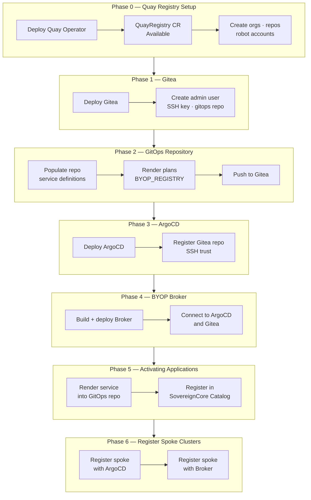

# Demo Setup

End-to-end deployment guide for the BYOP demo stack on an air-gapped OpenShift cluster.

## Environment Variables

All phases require environment variables to be set before running any script. See [`env.template`](env.template) for all variables and descriptions.

```bash
# Copy the template and fill in all values
cp env.template .env

# Source before running any phase
source .env
```

| Variable | Phase first needed | Description |
|----------|--------------------|-------------|
| `CLUSTER_DOMAIN` | 0 — Quay | OpenShift application domain (e.g. `apps.mycluster.example.com`) |
| `QUAY_REGISTRY` | 0 — Quay | Quay registry hostname |
| `GITEA_ROBOT_TOKEN` | 1 — Gitea | Quay robot token for the `gitea` org |
| `GITEA_PASSWORD` | 1 — Gitea | Gitea admin password |
| `GITEA_EMAIL` | 1 — Gitea | Gitea admin email |
| `GITEA_SSH_KEY_PATH` | 1 — Gitea | Path to Ed25519 private key registered in Gitea |
| `GITEA_HOST` | 1 — Gitea *(output)* | Node IP for Gitea SSH — set from `show-gitea-outputs.sh` |
| `GITEA_SSH_PORT` | 1 — Gitea *(output)* | NodePort for Gitea SSH — set from `show-gitea-outputs.sh` |
| `GITEA_USER_ID` | 1 — Gitea *(output)* | Gitea process UID — set from `show-gitea-outputs.sh` |
| `BYOP_REGISTRY` | 2 — GitOps repo | Registry name used when rendering service files — defaults to `$QUAY_REGISTRY`, override only if targeting a different registry |
| `ARGOCD_ROBOT_TOKEN` | 3 — ArgoCD | Quay robot token for the `argoproj` org |
| `BYOP_ROBOT_TOKEN` | 4 — Broker | Quay robot token for the `byop` org |

---

## Phases



---

### 0. Quay Registry Setup
[`quay/quay-deployment.md`](quay/quay-deployment.md)
One-time preparation of the Quay registry: create organizations, repositories, and robot accounts required by all later phases.

> On Sovereign Core, a Quay instance is already provided — skip this phase and set `QUAY_REGISTRY` to the existing hostname. For a standalone development environment, deploy Quay first and follow the image-mirroring guide: [`mirroring/quay-image-mirroring.md`](mirroring/quay-image-mirroring.md).

---

### 1. Gitea
[`gitea/gitea-deployment.md`](gitea/gitea-deployment.md)
Deploy the self-hosted Git server that backs the GitOps workflow. The guide includes after-installation steps to create the admin user, register the SSH key, and create the `gitops` repository.

---

### 2. GitOps Repository
[`repo/repo-deployment.md`](repo/repo-deployment.md)
Populate the `gitops` repository with service definitions. Renders all service plans against the local Quay registry and pushes them to Gitea.

---

### 3. ArgoCD
[`argocd/argocd-deployment.md`](argocd/argocd-deployment.md)
Deploy the GitOps engine. Registers the Gitea repository and lets ArgoCD trust the Gitea SSH key so it can clone manifests.

---

### 4. BYOP Broker
[`broker/broker-deployment.md`](broker/broker-deployment.md)
Build and deploy the Open Service Broker. Connects to ArgoCD and Gitea to provision service instances on demand.

---

### 5. Activating Applications
[`appactivate/appactivate.md`](appactivate/appactivate.md)
Render a service into the GitOps repository and register it as a service offering in the SovereignCore Catalog. The process has two phases: GitOps render (repeatable) and SovereignCore registration (create-only).

---

### 6. Register Spoke Clusters
[`argocdspokes/argocd-spokes.md`](argocdspokes/argocd-spokes.md)
Register additional spoke clusters with both the hub ArgoCD instance and the BYOP Broker. ArgoCD discovers the spoke via a labelled cluster Secret; the broker must be redeployed with the spoke's server URL added to its `clusters` list. When provisioning, SovereignCore passes the spoke's server URL as `cluster_url` in the service parameters.

---
*Made with IBM Bob*
