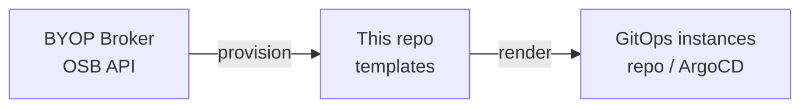
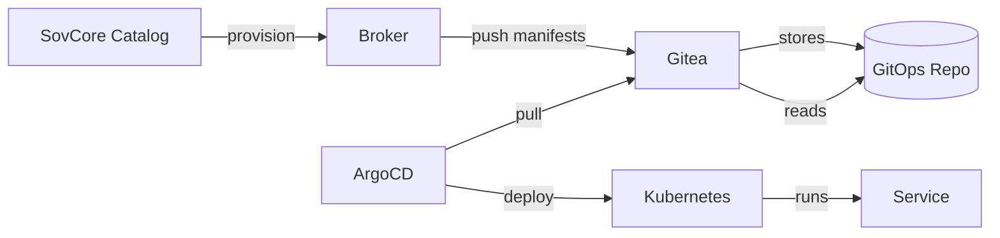
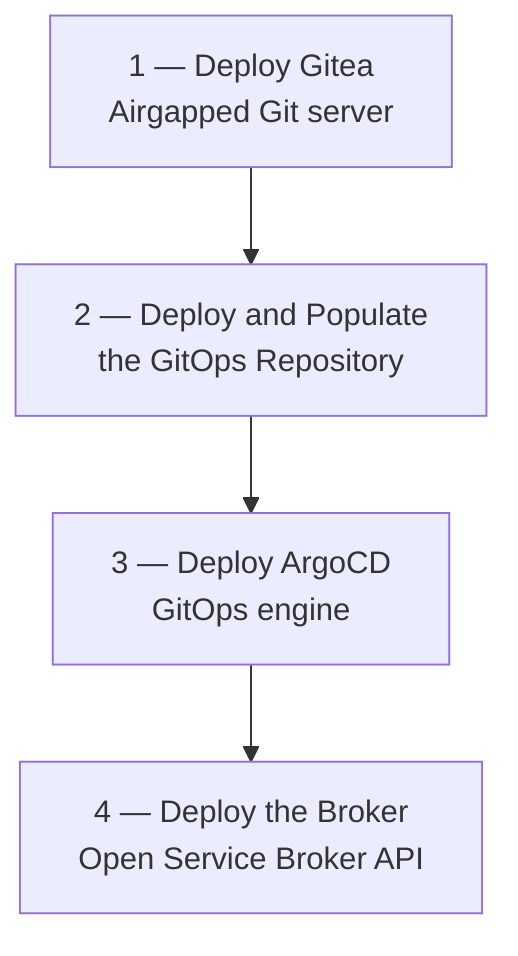

# Sovereign Core BYOP Sample Repository

This repository is the **service-definition source** for the BYOP (Bring Your Own Product) broker. It contains the Helm charts, Kustomize manifests, ArgoCD ApplicationSet templates, catalog descriptors, and tooling needed to offer self-service data services on Kubernetes or OpenShift via GitOps.

## Disclaimer

This repository is for development and demonstration purposes. It is not intended to be used in production. It depends on features that are still being developed.

## How it works

1. A consumer calls the broker (Open Service Broker API).
2. The broker reads the service definition from this repo (schema, templates, catalog).
3. It renders the Jinja2 template for the requested instance and commits the output to a separate GitOps instances repository.
4. ArgoCD detects the new commit and deploys the Helm release or Kustomize manifests to the target cluster.

---

## Architecture

---

## Deployment

See [`DEPLOY.md`](./DEPLOY.md) for the full end-to-end deployment guide.

The stack is deployed in four phases:

## Services

| Service | Catalog name | Deployment | App version | Description |
|---------|-------------|------------|-------------|-------------|
| [`etcdhelm`](services/etcdhelm/v1/README.md) | `etcdhelm` | Helm | v3.4.2 | Distributed key-value store for configuration and service discovery |
| [`keycloakhelm`](services/keycloakhelm/v1/README.md) | `keycloakhelm` | Helm | 26.6 | Identity and access management with SSO, OAuth2, and OpenID Connect |
| [`langflowhelm`](services/langflowhelm/v1/README.md) | `langflowhelm` | Helm | 1.10.2 | Low-code AI workflow builder — full stack (UI + backend) |
| [`langflowrthelm`](services/langflowrthelm/v1/README.md) | `langflowrthelm` | Helm | 1.10.2 | Langflow backend-only runtime, no UI |
| [`mariadbkz`](services/mariadbkz/v1/README.md) | `mariadb` | Kustomize | 12.3.2 | MariaDB relational database deployed via Kustomize manifests |
| [`mariadbhelm`](services/mariadbhelm/v1/README.md) | `mariadbhelm` | Helm | 12.3.2 | MariaDB relational database deployed via Helm |
| [`memcachedhelm`](services/memcachedhelm/v1/README.md) | `memcachedhelm` | Helm | 1.6.42 | High-performance distributed memory object caching system |
| [`mongodbhelm`](services/mongodbhelm/v1/README.md) | `mongodbhelm` | Helm | 7.0.34 | Document-oriented NoSQL database |
| [`mysqldbhelm`](services/mysqldbhelm/v1/README.md) | `mysqldbhelm` | Helm | 9.7.1 | MySQL relational database |
| [`odoohelm`](services/odoohelm/v1/README.md) | `odoohelm` | Helm | 18.0 | Open-source ERP and CRM platform |
| [`olgranitehelm`](services/olgranitehelm/v1/README.md) | `olgranitehelm` | Helm | 0.32.2 | Ollama inference server with IBM Granite 4 model pre-baked |
| [`postgreshelm`](services/postgreshelm/v1/README.md) | `postgreshelm` | Helm | 13.12 | PostgreSQL relational database |
| [`rabbitmqhelm`](services/rabbitmqhelm/v1/README.md) | `rabbitmqhelm` | Helm | 4.3.2 | Message broker supporting AMQP, MQTT, and STOMP |
| [`redishelm`](services/redishelm/v1/README.md) | `redishelm` | Helm | 8.6.3 | In-memory data structure store used as cache, database, and message broker |
| [`valkeyhelm`](services/valkeyhelm/v1/README.md) | `valkeyhelm` | Helm | 9.0.4 | Open-source Redis-compatible in-memory data store |
| [`vaulthelm`](services/vaulthelm/v1/README.md) | `vaulthelm` | Helm | 1.17.2 | Secrets management and data encryption platform |

Some charts in this repository are derived from open-source upstream projects:

- [groundhog2k/helm-charts](https://github.com/groundhog2k/helm-charts)
- [kubelauncher/charts](https://github.com/kubelauncher/charts)
- [langflow-ai/langflow-helm-charts](https://github.com/langflow-ai/langflow-helm-charts)
- [imio/helm-odoo](https://github.com/imio/helm-odoo)
- [otwld/ollama-helm](https://github.com/otwld/ollama-helm)
- [hashicorp/vault-helm](https://github.com/hashicorp/vault-helm)

---

## Creating an App

A step-by-step walkthrough showing how to wrap a pre-crafted, OpenShift SCC-compliant Helm chart into a full BYOP service descriptor — covering artifact inventory, catalog and schema authoring, broker template wiring, image mirroring into the air-gap registry, and activation in the GitOps repo. Uses nginx as the concrete example.

> 🤖 **Bob skills:** See [`SKILLS.md`](SKILLS.md) for a quick-reference on all available Bob skills and tools before diving in.

→ [`appcreate/appcreate.md`](appcreate/appcreate.md)

## Activating an App

Two-phase guide: render the service into the GitOps repo (repeatable), then register it as a service offering in the SovereignCore Catalog (create-only). Uses keycloakhelm as the concrete example.

→ [`appactivate/appactivate.md`](appactivate/appactivate.md)
