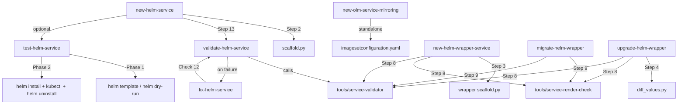
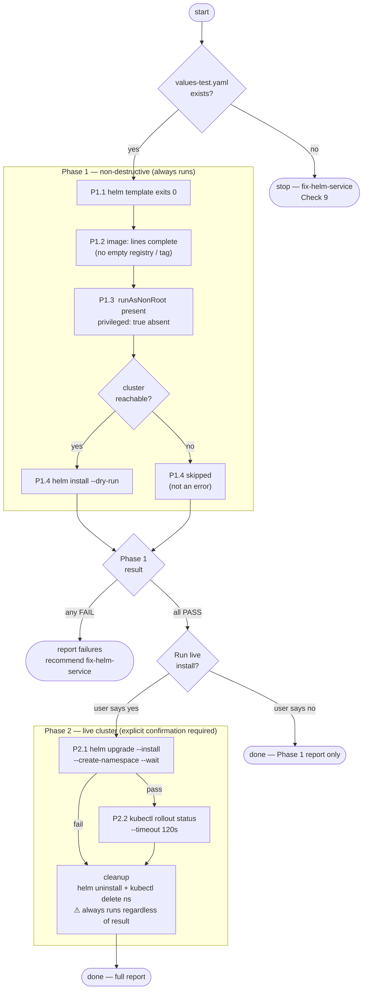

# SKILLS.md — BYOP Service Authoring Reference

Engineer-facing quick reference. Scannable in under 60 seconds.
For full instructions, load the skill in Bob: `use_skill <skill-name>`

---

## Skill dependency graph



---

## Skills quick-reference

| Skill | Load when you want to… | Produces | Calls |
|---|---|---|---|
| `new-helm-service` | Create a new Helm service from scratch | Full `services/<name>helm/v1/` tree | `scaffold.py`, `validate-helm-service` |
| `fix-helm-service` | Audit and fix an existing Helm service | Corrected files, passing validator | `validate-helm-service` |
| `validate-helm-service` | Check a service passes all 14 validator tests | Structured PASS/FAIL report | `tools/service-validator` |
| `test-helm-service` | Smoke-test a service locally | Phase 1/2 test report | `helm`, `kubectl` |
| `new-olm-service-mirroring` | Add OLM operator mirroring to a service | `imagesetconfiguration.yaml` operators stanza, CatalogSource, ICSP/IDMS | `oc-mirror` |
| `new-helm-wrapper-service` | Create a new Helm service from an upstream chart as an umbrella wrapper (preferred for new services) | `services/<name>helm/v1/` with the unmodified chart vendored in `chart/charts/<subchart>/` | wrapper `scaffold.py`, `service-render-check`, `service-validator` |
| `migrate-helm-wrapper` | Convert a hand-patched v1 Helm service into a wrapper `v2` | `services/<name>helm/v2/`; v1 untouched | `service-render-check`, `service-validator` |
| `upgrade-helm-wrapper` | Bump the upstream chart inside an existing wrapper service | Replaced `chart/charts/<subchart>/`, bumped `Chart.yaml`, key-diff report | `diff_values.py`, `service-render-check`, `service-validator` |

---

## Tools quick-reference

| Tool | Language | Purpose | Key flags |
|---|---|---|---|
| `tools/service-validator` | Python 3 | Run 14 static checks against a service definition | `--version v1`, `--all` |
| `tools/service-render` | — | Render `values.yaml.tmpl` → `values.yaml` using `image-mapping.txt` | `--mapping image-mapping.txt` |
| `tools/service-list` | — | List registered services | — |
| `tools/service-promote` | — | Promote a service version | — |
| `tools/service-reginfo` | — | Show registry info for a service | — |
| `tools/argocd-proxy` | — | Proxy to ArgoCD API | — |
| `.bob/skills/new-helm-service/scaffold.py` | Python 3 | Scaffold platform wrapper files for a new service | `--name`, `--image`, `--display`, `--version` |
| `tools/service-render-check` | Python 3 | Render the real `values.yaml.tmpl` with the broker renderer, `helm template` it, assert labels/annotations/pull secrets/`BYOP_REGISTRY`/PVC size | `<service>/<version>` (needs jinja2 + pyyaml, `BYOP_BROKER_SRC`) |
| `.bob/skills/new-helm-wrapper-service/scaffold.py` | Python 3 | Pull + vendor an upstream chart and scaffold the wrapper service | `--name`, `--display`, `--chart`, `--repo`, `--chart-version`, `--secret` |
| `.bob/skills/upgrade-helm-wrapper/diff_values.py` | Python 3 | Diff old vs new upstream `values.yaml`; flag wrapper-mapped keys that disappeared | `<service-version-dir> <new-chart-dir>` |

---

## How to load and use a skill

Tell Bob which skill to load before starting work:

```
use skill new-helm-service
```

Bob loads the full instructions into context and follows them step by step.
Skills are located in `.bob/skills/<name>/SKILL.md`.

---

## new-helm-service — 13-step map

| Step | What happens |
|---|---|
| 1 | Gather requirements: service name, image ref, parameters, chart source |
| 2 | Run `scaffold.py` — creates all platform wrapper files pre-filled from image ref |
| 3 | Fill in `catalog/catalog.yaml` — name, display_name, description, plan IDs |
| 4 | Fill in `catalog/schema.json` — add service-specific parameters, x-generate fields |
| 5 | Import Helm chart into `chart/` — `helm pull` or manual copy |
| 6 | Fix `chart/values.yaml` — split registry/repository, apply SCC defaults |
| 7 | Fix `chart/templates/` image rendering — `registry/repository:tag` pattern |
| 8 | Verify StatefulSet headless service (`clusterIP: None`) |
| 9 | Complete `template/values.yaml.tmpl` — add chart-specific value overrides |
| 10 | Fill in `imagesetconfiguration.yaml` — confirm image ref and tag |
| 11 | Add entry to `image-mapping.txt` |
| 12 | Complete `values-test.yaml` — add chart-specific test values, upstream registry |
| 13 | Write `README.md`; run `validate-helm-service` — all 14 tests must pass |

---

## fix-helm-service — 12-check map

| Check | What it audits / fixes |
|---|---|
| 1 | `catalog.yaml` — name matches directory, display_name and description are correct |
| 2 | `schema.json` — correct service, x-generate fields all have `\| yaml_safe` in template |
| 3 | Template header — `namespaceOverride`, `commonLabels`, `commonAnnotations`, `instance:`, `imagePullSecrets` format |
| 4 | SCC defaults — `fsGroup: null`, `seccompProfile`, `runAsNonRoot`, no hardcoded UIDs |
| 5 | Image split — `registry`/`repository` split in chart values and template; `BYOP_REGISTRY` in tmpl |
| 6 | `imagesetconfiguration.yaml` — every tmpl image has a corresponding mirror entry |
| 7 | StatefulSet headless service — `serviceName` points to `clusterIP: None` service |
| 8 | `metrics.json` — valid JSON with `metrics` array |
| 9 | `values-test.yaml` — exists, uses upstream registry (never `BYOP_REGISTRY`) |
| 10 | `image-mapping.txt` — entry exists for every image |
| 11 | `README.md` — exists and matches current chart/schema |
| 12 | Run `tools/service-validator` via `execute_command` — all 14 tests pass |

---

## test-helm-service — phase map



---

## validate-helm-service — 14 tests

| # | Test name | Checks |
|---|---|---|
| 0 | `directory-structure` | Required files and directories exist |
| 1 | `catalog-yaml` | `catalog.yaml` name field matches service directory |
| 2 | `schema-json` | `schema.json` is valid JSON |
| 3 | `chart-yaml` | `Chart.yaml` has name and appVersion |
| 4 | `values-yaml` | `chart/values.yaml` is valid YAML |
| 5 | `tmpl-jinja` | `values.yaml.tmpl` has no Jinja2 syntax errors |
| 6 | `values-test-exists` | `values-test.yaml` exists |
| 7 | `helm-template` | `helm template` exits 0 |
| 8 | `helm-template-images` | All `image:` lines have no empty segment after `helm template -f values-test.yaml` |
| 9 | `scc-keys` | `chart/values.yaml` has `runAsNonRoot`, `fsGroup: null`, `seccompProfile` |
| 10 | `byop-registry` | `template/values.yaml.tmpl` uses `BYOP_REGISTRY` (no hardcoded hostname) |
| 11 | `service-name` | Directory name is `[a-z]+` and ≤ 22 characters |
| 12 | `yaml-safe` | Every `x-generate` field in `schema.json` has `\| yaml_safe` in the template |
| 13 | `no-byop-registry-in-test` | `values-test.yaml` does not contain `BYOP_REGISTRY` |

Run with: `python3 tools/service-validator --version v1 services/<name>helm`

---

## Key platform constraints (cheat sheet)

| Constraint | Rule |
|---|---|
| Service name | `[a-z]+` only, ≤ 22 chars — broker appends `helm-<uuid>` → must stay ≤ 63 |
| `commonLabels` | v1 (non-wrapper) charts: always — never `customLabels`. **Wrapper charts:** use the knob the vendored chart actually reads (Groundhog2k: `<subchart>.customLabels` + `podLabels`); `commonLabels` is silently ignored by most upstream charts |
| `commonAnnotations` | v1 (non-wrapper) charts: always — never `customAnnotations`. **Wrapper charts:** `<subchart>.customAnnotations` + `podAnnotations`. Either way, all 4 `sovcore.byop.ibm.com/*` keys |
| `BYOP_REGISTRY` | Literal placeholder in `values.yaml.tmpl` — resolved via `image-mapping.txt` `BYOP_REGISTRY -> <host>` line |
| `values-test.yaml` | Must use upstream registry directly — never `BYOP_REGISTRY` |
| `x-generate` + `yaml_safe` | Every `x-generate` field **must** use `\| yaml_safe` in template — charset includes `{}`  which Helm silently drops |
| `selfHeal: true` | Required in all ApplicationSet templates — enforces GitOps contract |
| `fsGroup: null` | Required in `chart/values.yaml` — not `999`; lets OpenShift assign the group |
| Chart scope | `new-helm-service`: `chart/` is imported from upstream and hand-fixed. Wrapper skills: the upstream chart is vendored **unmodified** in `chart/charts/<subchart>/` — never edit it; all platform behaviour is values under `<subchart>:` |
| Wrapper key namespace | Everything in `template/values.yaml.tmpl` and `values-test.yaml` is nested under `<subchart>:`; drop `namespaceOverride`, `commonLabels`, `commonAnnotations`, `instance:` (the upstream reads none of them) |
| SCC check | Always pass a value when rendering (`--set <subchart>.fullnameOverride=t`); a bare `helm template` shows upstream UID 999 even on a healthy wrapper |
| `service-validator` | A bash script: `PATH=/tmp/jv/bin:$PATH bash tools/service-validator --version v2 <name>helm` (not `python3`) |
