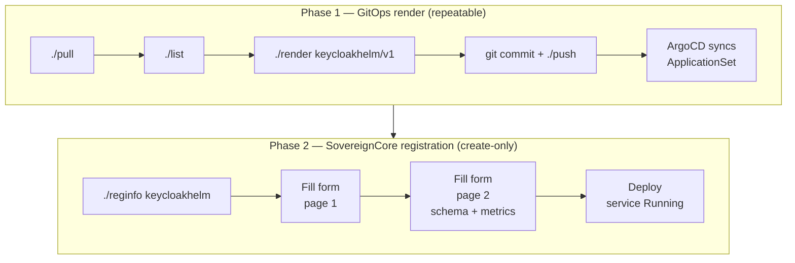
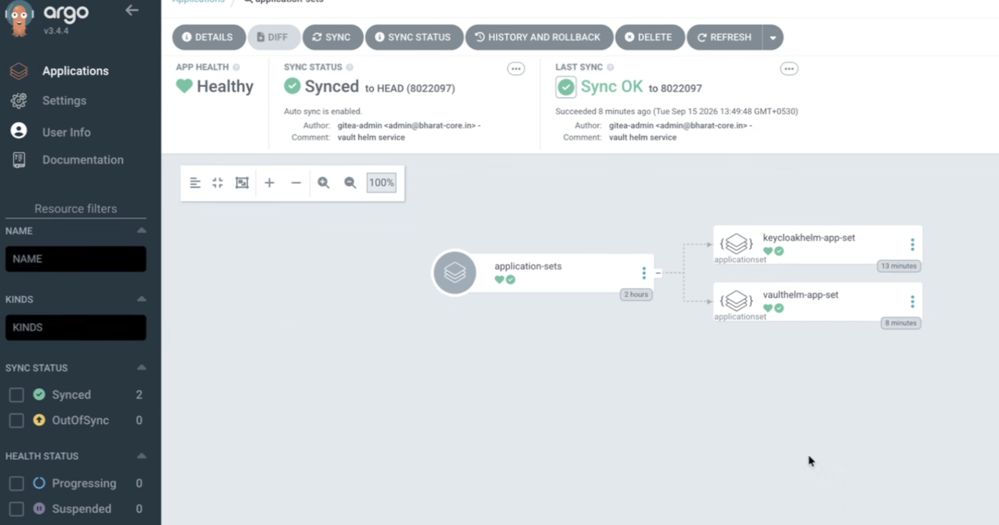
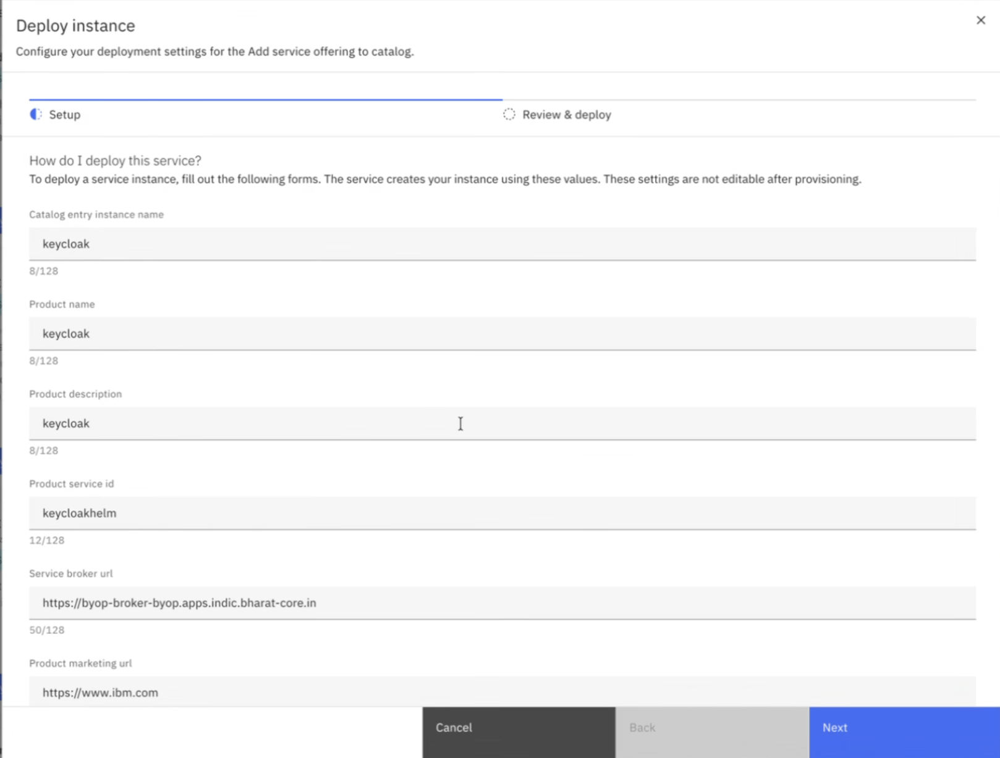
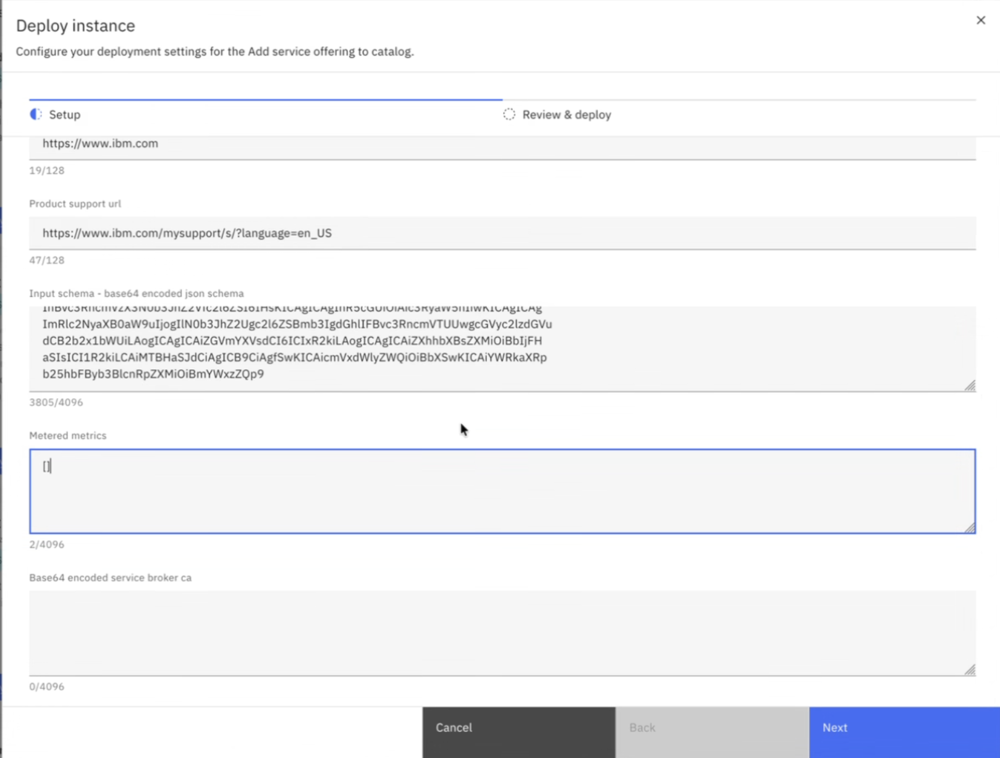
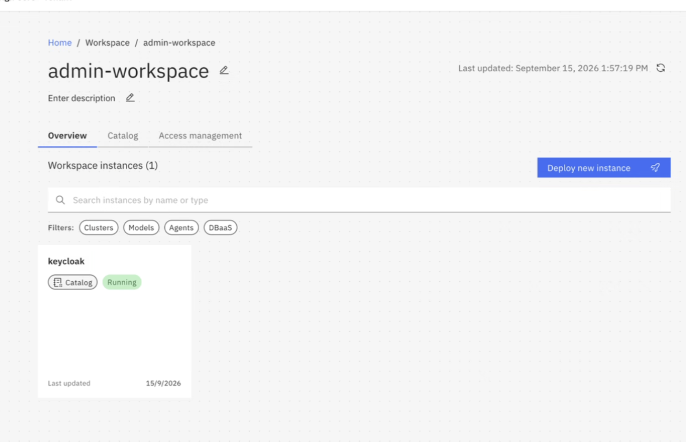

# Activating an Application

This guide covers the two phases needed to make a service available to users in SovereignCore. It uses **keycloakhelm** as the concrete example.

> **Prerequisite:** The service descriptor must already exist in `services/keycloakhelm/v1/` and the image must be mirrored into Quay (see [`appcreate/appcreate.md`](../appcreate/appcreate.md)).



---

## Phase 1 — Render into the GitOps repo

**Repeatable.** Re-run whenever the chart or template changes. Each push triggers ArgoCD reconciliation automatically.

```bash
cd repo/gitops

# Sync latest state from Gitea
./pull

# Inspect current service state before rendering
./list

# Render ApplicationSet + substitute BYOP_REGISTRY + set latest symlink
./render keycloakhelm/v1

# Commit and push to Gitea
git add .
git commit -m "enable keycloakhelm/v1"
./push
```

**Verify:** In ArgoCD, the `keycloakhelm-app-set` ApplicationSet appears and shows **Synced**.



---

## Phase 2 — Register in SovereignCore Catalog

**Create-only.** This step creates the catalog entry; it cannot be updated through this flow. If `catalog/schema.json` changes after registration, a new catalog entry must be created manually.

### Step 1 — Get the registration payload

```bash
cd repo/gitops
./reginfo keycloakhelm
```

Example output:

```
name: keycloakhelm
description: Full-lifecycle Keycloak identity service with broker-generated credentials stored in Git, deployed with Helm.
schema_base64: eyIkc2NoZW1hIjoiaHR0cDovL2pzb24tc2NoZW1hLm9yZy9kcmFmdC0wNy9zY2hlbWEjIiwidHlwZSI6...
metrics:
[]
```

Keep this output open — you will need to copy values from it into the form below.

### Step 2 — Open the SovereignCore form

In SovereignCore, navigate to **Workspace → Catalog tab → Deploy new instance → Add service offering to catalog**.

Fill **page 1** of the form:

| Field | Value |
|-------|-------|
| Catalog entry instance name | `keycloak` (short human name) |
| Product name | `keycloakhelm` (from `name:` in reginfo output) |
| Product description | first sentence from `description:` in reginfo output |
| Product service id | Must match the `id` field from the broker catalog — for most services `id == name`, but verify with: `curl -sk <broker-url>/v2/catalog \| python3 -m json.tool \| grep '"id"'` |
| Service broker url | broker route URL (from broker deployment outputs) |
| Product marketing url | `https://www.ibm.com` |
| Product support url | `https://www.ibm.com/mysupport/s/?language=en_US` |



Scroll down and fill **page 2**:

| Field | Value |
|-------|-------|
| Input schema — base64 encoded json schema | paste the `schema_base64:` value from reginfo output |
| Metered metrics | paste the `metrics:` block content from reginfo output (typically `[]`) |
| Base64 encoded service broker ca | **Sovereign Core:** always required — the broker route is signed by the Vault root CA. Retrieve with: `oc get secret vault-root-ca-secret -n vault-aas -o jsonpath='{.data.ca\.crt}'` — **Plain OCP (no Sovereign Core):** leave blank unless the broker uses a private CA |



### Step 3 — Review & deploy

Click **Next**, review the summary, then click **Deploy**.

**Verify:** The service appears in the workspace with status **Running**.



---

## What happens next

Once Phase 2 is complete, SovereignCore users can provision instances of the service from the Catalog. Each provisioning request is sent to the broker, which renders `template/values.yaml.tmpl` and commits the output to the GitOps repo. ArgoCD detects the commit and deploys the Helm release to the target cluster.

---

## Known Issues

### Upstream broker limitations

These are root-cause defects in the upstream `byop-broker`. Workarounds are documented here until upstream fixes land.

| # | Symptom | Root cause | Workaround | Issue |
|---|---------|-----------|-----------|-------|
| ~~#8~~ | ~~Helm release name exceeds 63 chars — chart render fails~~ | ~~`provision_templates.py` uses full `<service>helm-<uuid>` with no truncation~~ | ~~Add `fullnameOverride` to `values.yaml.tmpl`~~ | ~~#10 — **resolved**: `service-render` now validates name is `[a-z]+` and ≤ 22 chars~~ |
| ~~#11~~ | ~~Keycloak chart cannot find its Postgres DB — pod fails to start~~ | ~~Keycloak chart hardcodes `<fullname>-postgres` as the DB hostname~~ | ~~Set `postgres.fullnameOverride` to match~~ | ~~#9 — **resolved**: Keycloak chart fix shipped in `sample.tar.gz`~~ |
| #13 | Gitea push succeeds but ArgoCD never picks up the change — broker SSH agent is non-functional after pod restart | SSH agent state is not preserved across pod restarts | Run `oc rollout restart deployment/byop-broker -n byop` after each Gitea push, then re-trigger the provisioning | #8 |

### Common diagnostics

Operational conditions that look like bugs but have straightforward explanations and fixes.

| # | Symptom | Root cause | Resolution |
|---|---------|-----------|-----------|
| #7 | Pods in the instance namespace cannot pull images — `ImagePullBackOff` | Instance namespace has no pull secret — either the broker did not copy it, or the Quay repo is private | **Option A — copy the secret:** `oc get secret quay-pull-secret -n byop -o yaml \| sed 's/namespace: byop/namespace: <instance-ns>/' \| oc apply -f -` — **Option B — make the Quay repo public:** in the Quay UI, set the repository visibility to **Public** |
| #9 | Helm silently drops a generated password key — provisioning succeeds but the key is absent from `values.yaml` | `alphanumeric-symbols` charset produces `{` or `}` characters; Helm treats these as template delimiters and discards the key | Ensure every generated value is piped through `\| yaml_safe` in `template/values.yaml.tmpl` — e.g. `myPassword: {{ spec.my_password \| yaml_safe }}` (see [`appcreate/appcreate.md`](../appcreate/appcreate.md)) |
| #10 | Duplicate keys in `values.yaml` — second value silently wins, first is ignored | Common coding mistake: manually appending to an existing `values.yaml` produces duplicate keys; YAML parsers silently discard the first occurrence | Always rewrite the full file; never append to an existing `values.yaml` |
