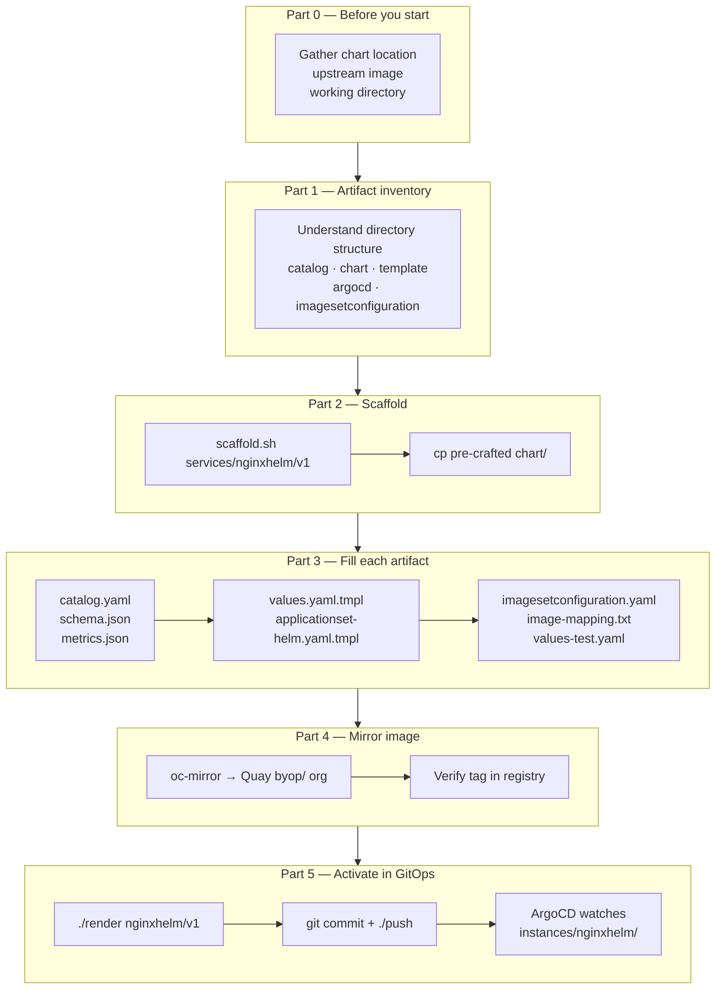
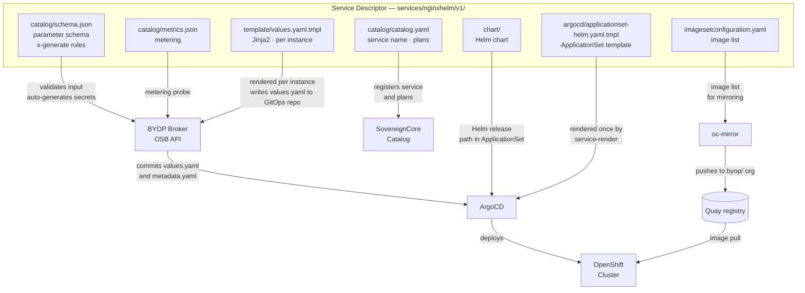
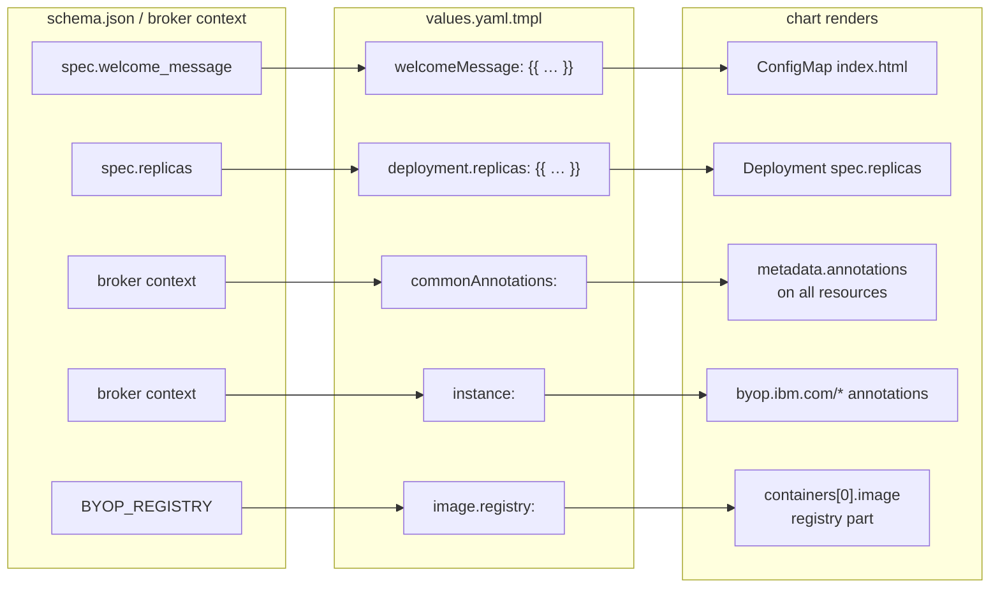

# Creating a New App — nginx Example

This tutorial walks through turning an existing Helm chart into a **BYOP service descriptor** and activating it on the platform. The nginx chart at [`appcreate/chart/`](chart/) is the concrete example.

> 🤖 **Bob skills:** Before starting, load [`SKILLS.md`](../SKILLS.md) for a quick-reference on the available Bob skills (`new-helm-service`, `fix-helm-service`, `validate-helm-service`, `test-helm-service`) and the tools that back them.




---

## Part 0 — Before you start

| Item | Value |
|------|-------|
| Chart location | `appcreate/chart/` (copy to `services/nginxhelm/v1/chart/`) |
| Upstream image | `docker.io/library/nginx:1.27.5` |
| Working directory for activation | `repo/gitops` |

A **service descriptor** is the set of files under `services/<name>helm/v1/` that tell the broker *what* to provision (catalog + schema), *how* to configure it (template), and *where* to get the image (imagesetconfiguration + image-mapping).

> **Service name constraints:** The `<name>` portion (without the `helm` suffix) must be **lowercase alphabetic only** (`[a-z]+`) and **≤ 22 characters**. The broker constructs the Helm release name as `<name>helm-<uuid>` (63 chars total); names longer than 22 chars push that over the Kubernetes 63-char label value limit. Digits, hyphens, and any other non-alpha characters are forbidden — they cause render failures.

---

## Part 1 — Artifact inventory

### Directory structure

Every service lives under `services/<name>helm/v1/` inside the GitOps repo:

```
services/nginxhelm/v1/
├── catalog/
│   ├── catalog.yaml                  ← service registration (name, plans)
│   ├── schema.json                   ← instance parameter schema + auto-generation rules
│   └── metrics.json                  ← metering hook (empty array if unused)
├── chart/                            ← Helm chart deployed by ArgoCD (pre-crafted)
│   ├── Chart.yaml
│   ├── values.yaml                   ← defaults + SCC baked in
│   └── templates/
│       ├── deployment.yaml
│       ├── configmap.yaml
│       ├── service.yaml
│       └── _helpers.tpl
├── template/
│   └── values.yaml.tmpl              ← Jinja2 template rendered once per instance
├── argocd/
│   └── applicationset-helm.yaml.tmpl ← rendered once per environment by service-render
├── imagesetconfiguration.yaml        ← images to mirror into the air-gap registry
└── values-test.yaml                  ← local test overrides (no broker, no airgap)
```

### Who consumes what

Each artifact has a primary consumer. Understanding this prevents confusion about why a file exists and what can be changed at runtime.



### Artifact reference table

| File | Consumer | Key constraint |
|------|----------|----------------|
| `catalog/catalog.yaml` | SovereignCore Catalog via Broker | `name` must match the directory name |
| `catalog/schema.json` | Broker — validates input, generates secrets | Use `x-generate` for auto-generated values; `required: []` unless no default exists |
| `catalog/metrics.json` | Broker — metering | Must be valid JSON: `{"metrics": []}` |
| `chart/` | ArgoCD — Helm release | Must support `commonLabels`, `commonAnnotations`, `instance` keys; SCC baked in |
| `template/values.yaml.tmpl` | Broker — rendered per instance | Maps `spec.<param>` → Helm values; `BYOP_REGISTRY` is a literal placeholder |
| `argocd/applicationset-helm.yaml.tmpl` | `service-render` then ArgoCD | Uppercase tokens substituted at render time; `{{ … }}` are ArgoCD variables, not Jinja2 |
| `imagesetconfiguration.yaml` | `oc-mirror` | Upstream refs only; one entry per image |

---

## Part 2 — Scaffold

The scaffold script creates the full directory skeleton with all placeholder files in one command. You then replace each placeholder with the nginx-specific content shown in Part 3.

Run from inside `repo/gitops`:

```bash
bash .bob/skills/new-helm-service/scaffold.sh services/nginxhelm/v1
```

Then copy the pre-crafted chart:

```bash
cp -r appcreate/chart services/nginxhelm/v1/chart
```

> The scaffold creates all placeholder files. The chart directory is then replaced with the real chart above.

---

## Part 3 — Fill each artifact

Each sub-section below gives the exact content for one file. Work through them top to bottom — later files use values defined earlier (the image tag in `values.yaml.tmpl` must match `imagesetconfiguration.yaml` and `image-mapping.txt`).

### `catalog/catalog.yaml`

```yaml
name: nginxhelm
display_name: Nginx Web Server
description: Full-lifecycle nginx web server with broker-managed configuration, deployed with Helm
plans:
  - id: standard
    name: Standard
    description: Standard nginx deployment
  - id: nginxhelm_plan
    name: Default
    description: Default nginx deployment
```

---

### `catalog/schema.json`

Two user-facing parameters plus the standard `cluster_url`:

```json
{
  "$schema": "http://json-schema.org/draft-07/schema#",
  "type": "object",
  "title": "Nginx Instance Parameters",
  "description": "Parameters for provisioning an nginx instance",
  "properties": {
    "cluster_url": {
      "type": "string",
      "description": "Target cluster server URL (optional, defaults to broker's cluster). Must be a registered ArgoCD cluster.",
      "format": "uri",
      "pattern": "^https://.*",
      "examples": ["https://kubernetes.default.svc"]
    },
    "welcome_message": {
      "type": "string",
      "description": "Text rendered into the default index.html page",
      "minLength": 1,
      "maxLength": 256,
      "default": "Welcome"
    },
    "replicas": {
      "type": "integer",
      "description": "Number of nginx pod replicas",
      "minimum": 1,
      "maximum": 10,
      "default": 1
    }
  },
  "required": [],
  "additionalProperties": false
}
```

> ⚠️ **Password fields:** Any value generated from an `x-generate` block must be rendered with `| yaml_safe` in `values.yaml.tmpl` (e.g. `myPassword: {{ spec.my_password | yaml_safe }}`). The `alphanumeric-symbols` charset includes `{` and `}` which Helm treats as template delimiters and silently drops the key — `yaml_safe` strips those characters before Helm sees the file.

---

### `chart/` — pre-crafted, no edits needed

The chart at `appcreate/chart/` is already complete and OpenShift SCC-compliant. Its key value paths are:

| `values.yaml` key | Wired by | Used in chart template |
|-------------------|----------|------------------------|
| `commonLabels` | `values.yaml.tmpl` | `metadata.labels` on Deployment + pod |
| `commonAnnotations` | `values.yaml.tmpl` | `metadata.annotations` on Deployment + pod (sovcore keys) |
| `instance.name/id/environment/clusterName` | `values.yaml.tmpl` | `byop.ibm.com/*` annotations |
| `image.registry` / `.repository` / `.tag` | `values.yaml.tmpl` | `containers[0].image` |
| `deployment.replicas` | `values.yaml.tmpl` | `spec.replicas` |
| `welcomeMessage` | `values.yaml.tmpl` | ConfigMap `index.html` body |

SCC defaults are baked into `chart/values.yaml` — `podSecurityContext` and `securityContext` are **never** set in the template.

---

### `template/values.yaml.tmpl`

```yaml
# Helm values override for nginx instance
namespaceOverride: {{ namespace }}
fullnameOverride: "{{ service_type }}-{{ instance_id[:8] }}"

commonLabels:
  app: nginx
  service-type: nginx

commonAnnotations:
  sovcore.byop.ibm.com/crn: {{ context.crn | default("crn:unknown") | yaml_safe }}
  sovcore.byop.ibm.com/account-id: {{ context.account_id | default("unknown") | yaml_safe }}
  sovcore.byop.ibm.com/sub-account-id: {{ context.sub_account_id | default("unknown") | yaml_safe }}
  sovcore.byop.ibm.com/platform: {{ context.platform | default("unknown") | yaml_safe }}

instance:
  name: {{ instance_name }}
  id: "{{ instance_id }}"
  environment: {{ environment }}
  clusterName: "{{ cluster_name }}"

imagePullSecrets:

  - name: {{ image_pull_secret_name }}

  []


image:
  registry: BYOP_REGISTRY
  repository: byop/nginx
  tag: "1.27.5"

deployment:
  replicas: {{ spec.replicas | default(1) }}

welcomeMessage: {{ spec.welcome_message | default("Welcome") | yaml_safe }}
```

> `BYOP_REGISTRY` is a **literal string** here — `service-render --mapping image-mapping.txt` replaces it with the actual airgap registry hostname at render time.

---

### `argocd/applicationset-helm.yaml.tmpl`

> **This file must be exactly this content — no deviation.** The scaffold already generates it. Verify it matches `services/vaulthelm/v1/argocd/applicationset-helm.yaml.tmpl` byte-for-byte.

```yaml
apiVersion: argoproj.io/v1alpha1
kind: ApplicationSet
metadata:
  name: SERVICE_NAME-app-set
  namespace: ARGOCD_NAMESPACE
  labels:
    app: SERVICE_NAME
    service-type: SERVICE_TYPE
spec:
  generators:
    - git:
        files:
          - path: "instances/SERVICE_NAME/*/metadata.yaml"
        repoURL: GITOPS_REPO_URL
        revision: GITOPS_REPO_REVISION
  syncPolicy:
    preserveResourcesOnDeletion: false
  template:
    metadata:
      labels:
        app: SERVICE_NAME
        service-type: SERVICE_TYPE
        instance: "{{ instance_name }}"
      name: "{{ service_type }}-{{ instance_name }}"
    spec:
      destination:
        server: "{{ cluster_url }}"
        namespace: "{{ namespace }}"
      project: ARGOCD_PROJECT
      source:
        path: services/SERVICE_NAME/SERVICE_VERSION/chart
        helm:
          valueFiles:
            - ../../../../instances/SERVICE_NAME/{{ instance_name }}/values.yaml
        repoURL: GITOPS_REPO_URL
        targetRevision: GITOPS_REPO_REVISION
      syncPolicy:
        automated:
          prune: true
          selfHeal: true
        syncOptions:
        - CreateNamespace=true
        retry:
          limit: 5
          backoff:
            duration: 5s
            factor: 2
            maxDuration: 3m
```

The uppercase tokens (`SERVICE_NAME`, `ARGOCD_NAMESPACE`, `ARGOCD_PROJECT`, `GITOPS_REPO_URL`, `GITOPS_REPO_REVISION`, `SERVICE_VERSION`, `SERVICE_TYPE`) are substituted by `service-render` at activation time. The `{{ … }}` expressions are ArgoCD ApplicationSet generator variables — they are **not** Jinja2 and must remain untouched.

> `selfHeal: true` ensures ArgoCD automatically re-applies any resource that drifts from or is deleted out-of-band from the GitOps repo. Set to `false` only if you intentionally want to allow manual out-of-band changes to persist.

---

### `imagesetconfiguration.yaml`

```yaml
kind: ImageSetConfiguration
apiVersion: mirror.openshift.io/v1alpha2
storageConfig:
  local:
    path: ./metadata
mirror:
  additionalImages:
    # Latest stable: docker.io/library/nginx:1.27.5
    - name: docker.io/library/nginx:1.27.5
```

---

### `image-mapping.txt` — append one entry

In the root `image-mapping.txt`, append:

```
# nginxhelm
docker.io/library/nginx:1.27.5  ->  localhost:5000/byop/nginx:1.27.5
```

---

### `values-test.yaml`

For local testing without the broker or airgap registry:

```yaml
# Usage:
#   helm upgrade --install nginx-test services/nginxhelm/v1/chart \
#     -f services/nginxhelm/v1/values-test.yaml \
#     --create-namespace \
#     --namespace nginx-test

namespaceOverride: nginx-test

commonLabels:
  app: nginx
  service-type: nginx

commonAnnotations:
  sovcore.byop.ibm.com/crn: crn:unknown
  sovcore.byop.ibm.com/account-id: local-test
  sovcore.byop.ibm.com/sub-account-id: local-test
  sovcore.byop.ibm.com/platform: local

instance:
  name: nginx-test
  id: "test-instance-001"
  environment: dev
  clusterName: "local"

image:
  registry: "docker.io"
  repository: "library/nginx"
  tag: "1.27.5"

imagePullSecrets: []

deployment:
  replicas: 1

welcomeMessage: "Hello from nginx test"
```

Validate:

```bash
helm template nginx-test services/nginxhelm/v1/chart \
  -f services/nginxhelm/v1/values-test.yaml 2>&1 | grep -E "image:|Welcome|replicas"
```

---

## Part 4 — Make the image available in the registry

Before the cluster can pull the nginx image, it must be mirrored from Docker Hub into the air-gap Quay registry under the `byop` organization. Three files collaborate here:

- `imagesetconfiguration.yaml` — lists the upstream source images; this is what `oc-mirror` reads
- `oc-mirror` — pulls from Docker Hub, pushes to Quay under `byop/nginx`
- `image-mapping.txt` — tells `service-render` how to rewrite `BYOP_REGISTRY` + image paths at render time

`imagesetconfiguration.yaml` is the input to `oc-mirror`. It pulls from Docker Hub and pushes into the air-gap Quay under the `byop` organization.

```bash
oc-mirror \
  --config services/nginxhelm/v1/imagesetconfiguration.yaml \
  docker://registry-quay-quay-enterprise.apps.<domain>
```

After mirroring, the image lands at `<BYOP_REGISTRY>/byop/nginx:1.27.5`. Verify:

```bash
curl -sk https://registry-quay-quay-enterprise.apps.<domain>/v2/byop/nginx/tags/list \
  -H "Authorization: Bearer <token>" | python3 -m json.tool
```

The tag `1.27.5` must appear before proceeding.

---

## Part 5 — Activate in the GitOps repo

With the descriptor files written and the image mirrored, render the ApplicationSet and push it to Gitea so ArgoCD can discover the service. `./render` calls `service-render` which:
- substitutes all uppercase tokens in `applicationset-helm.yaml.tmpl` with real environment values
- resolves `BYOP_REGISTRY` from `image-mapping.txt`
- writes the rendered `ApplicationSet` manifest into the repo

Once pushed, ArgoCD immediately begins watching `instances/nginxhelm/*/metadata.yaml`. When the broker provisions an instance, it commits `values.yaml` + `metadata.yaml` there — ArgoCD spawns an Application and deploys the Helm release automatically.

```bash
cd repo/gitops

./pull

./render nginxhelm/v1

git add .
git commit -m "enable nginxhelm/v1"
./push
```

What `./render nginxhelm/v1` does:
1. Reads `services/nginxhelm/v1/argocd/applicationset-helm.yaml.tmpl`
2. Substitutes uppercase tokens (`SERVICE_NAME` → `nginxhelm`, etc.)
3. Replaces `BYOP_REGISTRY` with the actual airgap hostname from `image-mapping.txt`
4. Writes the rendered `ApplicationSet` into the repo

---

## Value flow summary


