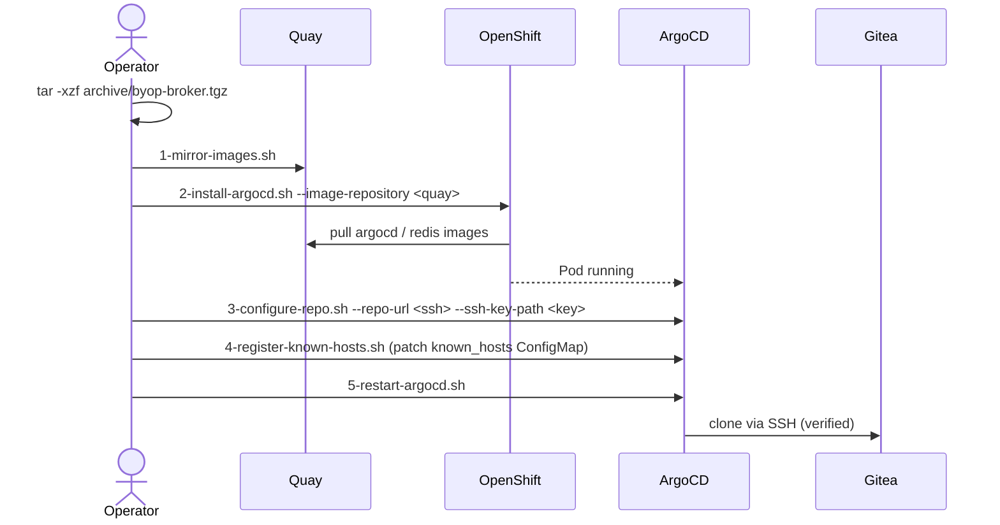

# ArgoCD — Deployment Guide

## Scripts

| Orchestrator | `deploy-argocd.sh` |
|---|---|
| Phase 1 | `1-mirror-images.sh` — Mirror images to Quay |
| Phase 2 | `2-install-argocd.sh` — Install ArgoCD |
| Phase 3 | `3-configure-repo.sh` — Configure Gitea repository |
| Phase 4 | `4-register-known-hosts.sh` — Register Gitea SSH host key |
| Phase 5 | `5-restart-argocd.sh` — Restart ArgoCD |

---

## Overview

This guide covers the full **ArgoCD** deployment on an air-gapped OpenShift cluster:

0. Extract the source
1. Mirror images to the private Quay registry
2. Install ArgoCD
3. Configure the GitOps repository
4. Register the Gitea SSH host key in ArgoCD known_hosts
5. Restart ArgoCD

ArgoCD is the GitOps engine that keeps the cluster aligned with the manifests stored in Gitea. The byop-broker creates ArgoCD Application resources at provisioning time.

> **Automated alternative:** You can run the scripts in [`tools.md`](./tools.md) instead. Each phase can be run individually or all at once via `deploy-argocd.sh`.

---

## Deployment Flow



---

## Prerequisites

### Tools

| Tool | Version | Purpose |
|------|---------|---------|
| `podman` | any recent | Mirror images to Quay |
| `oc` | matching cluster | Target cluster access |
| `ssh-keyscan` | any | Retrieve Gitea SSH host key |
| `python3` | any | Used by configure-repo script |

- Ensure your kubeconfig points to the correct cluster before running any command.
- Deploy and verify Gitea before running Steps 3 and 4.

### Information needed before you start

| Information | Where to find it | Example |
|-------------|-----------------|---------|
| Quay registry hostname | Quay Web UI → top bar | `registry-quay-quay-enterprise.apps.<domain>` |
| `argoproj+argocd_push` robot token | Quay Web UI → org `argoproj` → Robot Accounts | `<token string>` |
| Gitea SSH host | See Gitea deployment Outputs | `$GITEA_HOST` |
| Gitea SSH port | See Gitea deployment Outputs | `$GITEA_SSH_PORT` |
| Gitea user numeric ID | See Gitea deployment Outputs | `$GITEA_USER_ID` |
| SSH Ed25519 private key path | Generated during Gitea setup | `~/.ssh/gitea_ed25519` |
| Source archive path | Fixed location in delivery package | `archive/byop-broker.tgz` |

Export these environment variables once before starting:

```bash
export QUAY_REGISTRY="registry-quay-quay-enterprise.apps.<domain>"
export ARGOCD_ROBOT_TOKEN="<get from Quay UI — argoproj+argocd_push>"
export GITEA_HOST=""        # from Gitea deployment Outputs
export GITEA_SSH_PORT=""    # from Gitea deployment Outputs
export GITEA_USER_ID=""     # from Gitea deployment Outputs
export GITEA_SSH_KEY_PATH="~/.ssh/gitea_ed25519"
```

> **Security note**: never commit tokens or private key paths to version control. Store them in a secrets manager or a local `.env` file excluded from git.

---

## Step 0 — Extract Source

```bash
tar -xzf archive/byop-broker.tgz
```

Then navigate to the `argocd/` subdirectory:

```bash
cd byop-broker/argocd
```

---

## Step 1 — Mirror Images to Quay

`1-mirror-images.sh` mirrors all required images. To do it manually:

```bash
podman login -u="argoproj+argocd_push" -p="${ARGOCD_ROBOT_TOKEN}" ${QUAY_REGISTRY}

# ArgoCD
podman pull quay.io/argoproj/argocd:v3.4.4
podman tag  quay.io/argoproj/argocd:v3.4.4 ${QUAY_REGISTRY}/argoproj/argocd:v3.4.4
podman push ${QUAY_REGISTRY}/argoproj/argocd:v3.4.4

# Redis (sidecar required by ArgoCD)
podman pull docker.io/library/redis:8.2.3-alpine
podman tag  docker.io/library/redis:8.2.3-alpine ${QUAY_REGISTRY}/argoproj/redis:8.2.3-alpine
podman push ${QUAY_REGISTRY}/argoproj/redis:8.2.3-alpine
```

---

## Step 2 — Install ArgoCD

`2-install-argocd.sh` deploys ArgoCD from the bundled install script. All commands must be run from the **`argocd/` subdirectory** (Step 0):

```
byop-broker/
└── argocd/                        ← run scripts from here
    └── scripts/
        └── admin/
            ├── argocd-install.sh
            └── argocd-configure-repo.sh
```

```bash
./scripts/admin/argocd-install.sh \
  --namespace argocd \
  --image-repository ${QUAY_REGISTRY}/argoproj
```

After install, the script patches ArgoCD to use **annotation-based resource tracking**:

```bash
oc patch configmap argocd-cm -n argocd --type=merge \
  -p '{"data":{"application.resourceTrackingMethod":"annotation"}}'
```

> Label-based tracking (the default) stores the Application name as a Kubernetes label value, which is capped at 63 characters. App names derived from `<service>helm-<uuid>` push ArgoCD's internally composed label values over this limit, breaking pod scheduling. Annotation mode has no length restriction.

### Verify the rollout

```bash
# Watch pod status
oc get pods -n argocd -w

# Inspect ArgoCD server logs
oc logs -n argocd deployment/argocd-server --tail=50
```

---

## Step 3 — Configure the GitOps Repository

`3-configure-repo.sh` registers the Gitea SSH repository so ArgoCD can clone manifests from it. To do it manually:

```bash
./scripts/admin/argocd-configure-repo.sh \
  --namespace argocd \
  --repo-url ssh://${GITEA_USER_ID}@${GITEA_HOST}:${GITEA_SSH_PORT}/gitops/gitops.git \
  --ssh-key-path ${GITEA_SSH_KEY_PATH}
```

---

## Step 4 — Register the Gitea SSH Host Key

`4-register-known-hosts.sh` adds the Gitea host key to ArgoCD's `known_hosts` ConfigMap. To do it manually:

### 4a. Scan the Gitea host key

```bash
ssh-keyscan -p ${GITEA_SSH_PORT} ${GITEA_HOST} | grep ssh- 2>/dev/null
```

Copy the output line — it will look like:

```
[192.168.2.27]:30022 ssh-rsa AAAA...
```

### 4b. Append it to the ArgoCD ConfigMap

```bash
GITEA_KEY="[${GITEA_HOST}]:${GITEA_SSH_PORT} ssh-rsa <paste-key-here>"   # ← CUSTOMIZE

CURRENT=$(oc get cm argocd-ssh-known-hosts-cm -n argocd \
  -o jsonpath="{.data.ssh_known_hosts}")

printf "%s\n%s\n" "$CURRENT" "$GITEA_KEY" > /tmp/new_known_hosts.txt

oc create configmap argocd-ssh-known-hosts-cm \
  --from-file=ssh_known_hosts=/tmp/new_known_hosts.txt \
  --dry-run=client -o yaml -n argocd | oc apply -f - -n argocd
```

### 4c. Verify

```bash
oc get cm argocd-ssh-known-hosts-cm -n argocd \
  -o jsonpath="{.data.ssh_known_hosts}" | grep "${GITEA_HOST}"
```

A matching line confirms the key is registered.

---

## Step 5 — Restart ArgoCD

`5-restart-argocd.sh` restarts the ArgoCD deployments so they use the updated ConfigMap. To do it manually:

```bash
oc rollout restart deployment -n argocd
oc rollout status deployment/argocd-server -n argocd
```

ArgoCD will now successfully clone from Gitea over SSH.

---
*Made with IBM Bob*
