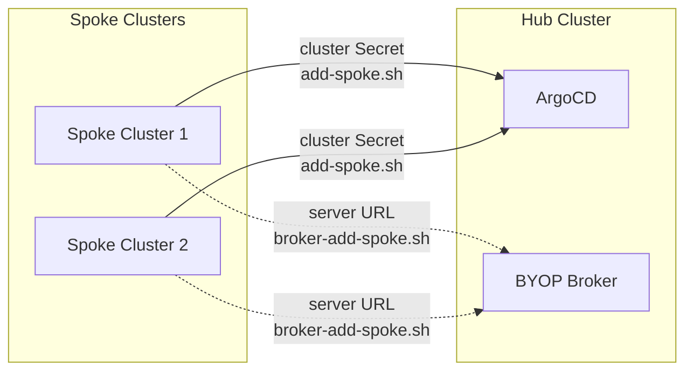
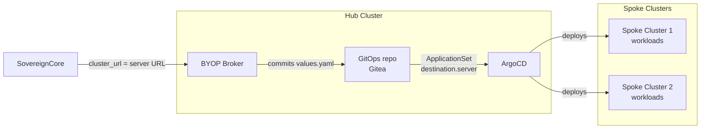
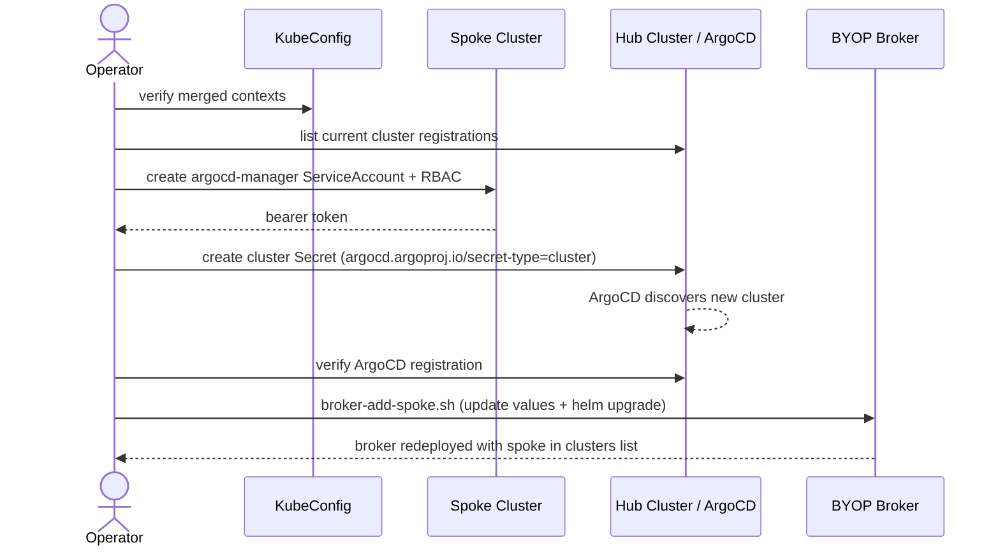

# ArgoCD Spokes — Guide

## Scripts

| Script | Role |
|---|---|
| `add-spoke.sh` | Validate contexts, list current registrations, register a spoke cluster with the hub ArgoCD instance |
| `broker-add-spoke.sh` | Add a spoke cluster entry to the broker `values-generated.yaml` and redeploy |
| `broker-remove-spoke.sh` | Remove a spoke cluster entry from the broker `values-generated.yaml` and redeploy |

---

## Architecture

**Registration** — run once per spoke, before any provisioning:



**Provisioning** — what happens each time SovereignCore provisions a service:



> **`cluster_url` must be the spoke's server URL** — for example `https://192.168.2.89:6443`. The broker's cluster lookup is keyed by server URL; the friendly `name` field is used for logging only and cannot be used in provisioning requests.

---

## Controlling deployment target per service

By default the ApplicationSet template for every service uses `{{ cluster_url }}` as the ArgoCD destination — meaning the target cluster is determined at provision time by whatever `cluster_url` SovereignCore passes to the broker.

You can **override this per service** by editing its `applicationset-helm.yaml.tmpl` in the GitOps repo and replacing the dynamic value with a hardcoded server URL. This is useful when a service must always deploy to the hub regardless of what the user specifies, or always deploy to a specific spoke.

In `services/<name>helm/v1/argocd/applicationset-helm.yaml.tmpl`:

```diff
     spec:
       destination:
-        server: "{{ cluster_url }}"
+        server: "https://kubernetes.default.svc"
         namespace: "{{ namespace }}"
```

To pin to a specific spoke instead:

```diff
     spec:
       destination:
-        server: "{{ cluster_url }}"
+        server: "https://192.168.2.89:6443"
         namespace: "{{ namespace }}"
```

After editing the template, re-render and push the service:

```bash
cd repo/gitops
./render <servicename>/v1
git add .
git commit -m "pin <servicename> to hub"
./push
```

ArgoCD will pick up the updated ApplicationSet on the next sync. Existing instances are not affected until they are reprovisioned.

> **Note:** `{{ cluster_url }}` is an ArgoCD ApplicationSet generator variable, not a Jinja2 expression — it is populated from `metadata.yaml` in the GitOps repo, which the broker writes at provision time. It is **not** the same as the `{{ cluster_url }}` schema parameter.

---

## Overview

This guide covers registering an additional **spoke cluster** with a hub ArgoCD instance on OpenShift and making it available to the broker for service provisioning:

1. Prepare kubeconfig — verify both hub and spoke contexts are present and reachable
2. List current cluster registrations
3. Register the spoke with ArgoCD — create the `argocd-manager` ServiceAccount and RBAC on the spoke, extract its bearer token, and create the cluster Secret on the hub
4. Register the spoke with the broker — add the spoke server URL to the broker clusters list and redeploy

> **Automated alternative:** Run the scripts in [`tools.md`](./tools.md). Steps 3 and 4 each have a dedicated script. Step 2 uses `--list`.

---

## Deployment Flow



---

## Prerequisites

### Tools

| Tool | Purpose |
|---|---|
| `oc` | Cluster access for both hub and spoke |

- Ensure your kubeconfig contains merged contexts for both the hub and the spoke before running any command.

### Information needed before you start

| Information | Where to find it |
|---|---|
| Hub kubeconfig context name | `oc config get-contexts` |
| Spoke kubeconfig context name | `oc config get-contexts` |
| ArgoCD namespace on hub | `argocd` (default) — verify with `oc get ns` |

All values are passed as flags to `add-spoke.sh`. No environment variables are required.

---

## Step 1 — Prepare kubeconfig

Confirm that both contexts are present in your merged kubeconfig:

```bash
oc config get-contexts
```

The output lists all available contexts. Identify the names for your hub and spoke clusters. Then verify that both are reachable:

```bash
# Hub
oc --context=<hub-context> whoami

# Spoke
oc --context=<spoke-context> whoami
```

Each command should return your username on the respective cluster. If either fails, update your kubeconfig before continuing.

---

## Step 2 — List current cluster registrations

### Automated

```bash
./add-spoke.sh --hub-context <hub-context> --list
```

### Manual equivalent

```bash
oc --context=<hub-context> get secrets \
  -n argocd \
  -l argocd.argoproj.io/secret-type=cluster
```

Both commands show the cluster Secrets currently registered with ArgoCD on the hub. No changes are made.

---

## Step 3 — Register the spoke

### Automated

```bash
./add-spoke.sh \
  --hub-context <hub-context> \
  --spoke-context <spoke-context> \
  --namespace argocd \
  --spoke-name <friendly-name>
```

`--namespace` defaults to `argocd` and may be omitted. `--spoke-name` defaults to the spoke context name.

If the spoke's CA certificate cannot be extracted, the script uses an insecure connection automatically and prints a warning. To explicitly force an insecure connection, pass `--force-insecure`:

```bash
./add-spoke.sh \
  --hub-context <hub-context> \
  --spoke-context <spoke-context> \
  --force-insecure
```

Use this only when necessary. It sets `tlsClientConfig.insecure` to `true` in the ArgoCD cluster Secret, disabling TLS certificate verification.

Run with `--dry-run` first to preview the secret name and the sequence of actions without making any changes:

```bash
./add-spoke.sh \
  --hub-context <hub-context> \
  --spoke-context <spoke-context> \
  --dry-run
```

### Manual equivalent

The script performs three logical sub-steps. To do them manually:

#### 3a. Create `argocd-manager` ServiceAccount and RBAC on the spoke

```bash
oc --context=<spoke-context> apply -f - <<EOF
apiVersion: v1
kind: Namespace
metadata:
  name: argocd
---
apiVersion: v1
kind: ServiceAccount
metadata:
  name: argocd-manager
  namespace: argocd
---
apiVersion: v1
kind: Secret
metadata:
  name: argocd-manager-token
  namespace: argocd
  annotations:
    kubernetes.io/service-account.name: argocd-manager
type: kubernetes.io/service-account-token
---
apiVersion: rbac.authorization.k8s.io/v1
kind: ClusterRole
metadata:
  name: argocd-manager-role
rules:
- apiGroups: ['*']
  resources: ['*']
  verbs: ['*']
- nonResourceURLs: ['*']
  verbs: ['*']
---
apiVersion: rbac.authorization.k8s.io/v1
kind: ClusterRoleBinding
metadata:
  name: argocd-manager-role-binding
roleRef:
  apiGroup: rbac.authorization.k8s.io
  kind: ClusterRole
  name: argocd-manager-role
subjects:
- kind: ServiceAccount
  name: argocd-manager
  namespace: argocd
EOF
```

All resources are applied idempotently; re-running is safe.

#### 3b. Extract the bearer token

```bash
TOKEN=$(oc --context=<spoke-context> -n argocd get secret argocd-manager-token \
  -o jsonpath='{.data.token}' | base64 -d)
```

If the token field is empty, wait a few seconds and retry — the controller may not have populated it yet.

#### 3c. Create the cluster Secret on the hub

```bash
SPOKE_SERVER=$(oc --context=<spoke-context> config view --minify \
  -o jsonpath='{.clusters[0].cluster.server}')

oc --context=<hub-context> apply -f - <<EOF
apiVersion: v1
kind: Secret
metadata:
  name: cluster-<spoke-name>
  namespace: argocd
  labels:
    argocd.argoproj.io/secret-type: cluster
type: Opaque
stringData:
  name: <spoke-name>
  server: "${SPOKE_SERVER}"
  config: |
    {"bearerToken": "${TOKEN}", "tlsClientConfig": {"insecure": false}}
EOF
```

Replace `<spoke-name>` with a lowercase, hyphen-safe identifier (e.g. `spoke-east`). Set `"insecure": true` only if you cannot extract a CA certificate. The automated script supports `--force-insecure` when this behavior must be explicit.

---

## Outputs

After registration, verify that the cluster Secret appears on the hub:

```bash
# List all registered clusters
oc --context=<hub-context> -n argocd get secrets \
  -l argocd.argoproj.io/secret-type=cluster

# Inspect the specific secret
oc --context=<hub-context> -n argocd get secret cluster-<spoke-name> -o yaml
```

A successful registration shows the secret with label `argocd.argoproj.io/secret-type=cluster`. ArgoCD will detect it automatically — no restart is needed. The cluster will appear in the ArgoCD UI under **Settings → Clusters** within a few seconds.

---

## Step 4 — Register the spoke with the broker

After ArgoCD recognises the spoke, add it to the broker's cluster list so it can provision services there.

### Automated

```bash
./broker-add-spoke.sh \
  --source <path-to-byop-broker> \
  --spoke-context <spoke-context> \
  --spoke-name <friendly-name>
```

`--spoke-name` defaults to the context name. Run with `--dry-run` first to preview:

```bash
./broker-add-spoke.sh \
  --source <path-to-byop-broker> \
  --spoke-context <spoke-context> \
  --dry-run
```

### Manual equivalent

**4a. Find the spoke server URL:**

```bash
SPOKE_SERVER=$(oc --context=<spoke-context> config view --minify \
  -o jsonpath='{.clusters[0].cluster.server}')
echo $SPOKE_SERVER
```

**4b. Append the entry to `values-generated.yaml`:**

```yaml
# In <path-to-byop-broker>/values-generated.yaml, under broker.clusters:
broker:
  clusters:
    - server: "https://kubernetes.default.svc"
      name: "in-cluster"
      type: "hub"
      default: true
    - server: "<SPOKE_SERVER>"   # ← add this
      name: "<friendly-name>"
      type: "spoke"
```

**4c. Redeploy the broker:**

```bash
cd <path-to-byop-broker>
helm upgrade --install byop ./chart \
  --namespace byop \
  --create-namespace \
  --values values-generated.yaml

oc rollout status deployment/byop-broker -n byop --timeout=5m
```

### Removing a spoke from the broker

```bash
./broker-remove-spoke.sh \
  --source <path-to-byop-broker> \
  --spoke-name <friendly-name>
```

The script removes the entry by name, guards against removing the hub entry, and redeploys the broker. Use `--dry-run` to preview.

### Verify

```bash
# The CLUSTERS env var on the broker pod lists all configured clusters
oc exec -n byop deployment/byop-broker -- env | grep CLUSTERS
```

---
*Made with IBM Bob*
