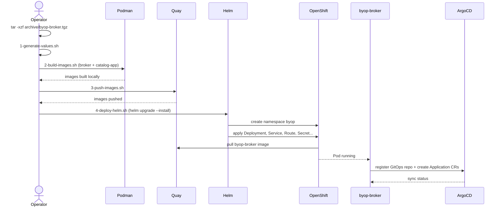

# BYOP Broker — Deployment Guide

## Scripts

| Orchestrator | `deploy-byop-broker.sh` |
|---|---|
| Phase 1 | `1-generate-values.sh` — Generate values file |
| Phase 2 | `2-build-images.sh` — Build broker and catalog-app images |
| Phase 3 | `3-push-images.sh` — Push images to Quay |
| Phase 4 | `4-deploy-helm.sh` — Deploy with Helm |

---

## Overview

This guide covers the full **byop-broker** deployment on an air-gapped OpenShift cluster:

0. Extract the source
1. Generate the values file
2. Build source images with Podman
3. Push images to the private Quay registry
4. Deploy with `helm upgrade --install`

The broker exposes an Open Service Broker API and uses ArgoCD to provision services through GitOps. The optional **byop-catalog-app** is a test UI for the broker API.

> **Automated alternative:** You can run the scripts in [`tools.md`](./tools.md) instead. Each phase can be run individually or all at once via `deploy-byop-broker.sh`.

---

## Deployment Flow



---

## Prerequisites

### Tools

| Tool | Version | Purpose |
|------|---------|---------|
| `podman` | any recent | Build and push container images |
| `helm` | ≥ 3.x | Deploy the Helm chart |
| `oc` | matching cluster | Target cluster access |

- Set your kubeconfig correctly before running any command.
- Configure default storage on the target cluster.

### Information needed before you start

| Information | Where to find it | Example |
|-------------|-----------------|---------|
| Quay registry hostname | Quay Web UI → top bar | `registry-quay-quay-enterprise.apps.<domain>` |
| `byop+byop_push` robot token | Quay Web UI → org `byop` → Robot Accounts | `<token string>` |
| Cluster apps domain | `oc get ingresses.config cluster -o jsonpath='{.spec.domain}'` | `apps.mycluster.example.com` |
| Gitea SSH host | See Gitea deployment Outputs | `$GITEA_HOST` |
| Gitea SSH port | See Gitea deployment Outputs | `$GITEA_SSH_PORT` |
| Gitea user numeric ID | See Gitea deployment Outputs | `$GITEA_USER_ID` |
| SSH Ed25519 private key | Generated during Gitea setup | `~/.ssh/gitea_ed25519` |
| Source archive path | Fixed location in delivery package | `archive/byop-broker.tgz` |

Export these environment variables once before starting:

```bash
export QUAY_REGISTRY="registry-quay-quay-enterprise.apps.<domain>"
export BYOP_ROBOT_TOKEN="<get from Quay UI — byop+byop_push>"
export CLUSTER_DOMAIN="<cluster-apps-domain>"
export GITEA_HOST=""        # from Gitea deployment Outputs
export GITEA_SSH_PORT=""    # from Gitea deployment Outputs
export GITEA_USER_ID=""     # from Gitea deployment Outputs
export GITEA_SSH_KEY_PATH="~/.ssh/gitea_ed25519"
```

---

## Step 0 — Extract Source

```bash
tar -xzf archive/byop-broker.tgz
```

Then enter the project directory:

```bash
cd byop-broker
```

---

## Step 1 — Generate the Values File

`1-generate-values.sh` produces a `values.yaml` configured for your cluster. You can also build it manually from the template below.

Copy the template to a file named after your target cluster (e.g. `my-cluster.yaml`):

```yaml
global:
  imageRegistry: ""     # $QUAY_REGISTRY
  imageOrganization: byop

cluster:
  domain: ""            # $CLUSTER_DOMAIN

broker:
  image:
    tag: "1.5.5-01"

  auth:
    enabled: false
    verifySSL: false

  dashboardUrlTemplate: ""  # https://argocd-server-argocd.apps.$CLUSTER_DOMAIN/applications/argocd/{instance_id}?view=tree&resource=

  gitops:
    repoUrl: ""         # ssh://$GITEA_USER_ID@$GITEA_HOST:$GITEA_SSH_PORT/gitops/gitops.git

  clusters:
    - server: "https://kubernetes.default.svc"
      name: "in-cluster"
      type: "hub"
      default: true

  secrets:
    sshPrivateKey: |
      # paste content of $GITEA_SSH_KEY_PATH here, preserving indentation

catalogApp:
  enabled: true
  image:
    tag: "1.0.4-01"
```

> ⚠️ **`$GITEA_USER_ID` is the numeric UID, not the username string.**
> Gitea SSH URLs require the account's internal numeric ID (e.g. `1000900000`), not the login name `gitops`. Using the string username produces a silently accepted but broken config.
> Retrieve the correct value with:
> ```bash
> ./show-gitea-outputs.sh   # look for GITEA_USER_ID
> ```
> Example resulting URL: `ssh://1000900000@192.168.2.39:30022/gitops/gitops.git`


### Customization Checklist

| # | Field | Required | Notes |
|---|-------|----------|-------|
| 1 | `global.imageRegistry` | ✅ | Quay hostname for your cluster |
| 2 | `cluster.domain` | ✅ | Apps domain, no `https://` prefix |
| 3 | `broker.image.tag` | ✅ | Must match the pushed image tag |
| 3 | `broker.auth.enabled` | ⚠️ | Set `true` + `verifySSL: true` in production |
| 3 | `broker.dashboardUrlTemplate` | Optional | ArgoCD link shown in service dashboard |
| 4 | `broker.gitops.repoUrl` | ✅ | SSH URL of the GitOps repo in Gitea — use numeric `$GITEA_USER_ID`, not the username (see callout above) |
| 5 | `broker.clusters` | ✅ | Add spoke entries for multi-cluster |
| 6 | `broker.secrets.sshPrivateKey` | ✅ | Private key registered in Gitea |
| 7 | `catalogApp.enabled` | Optional | Disable for headless production installs |
| 7 | `catalogApp.image.tag` | ✅ if enabled | Must match the pushed image tag |

---

## Step 2 — Build Images

`2-build-images.sh` builds both images from source. To do it manually, run from the root of the extracted source directory (Step 0):

### Catalog App

```bash
cd catalog-app
podman build -t localhost/byop-catalog-app:1.0.4-01 .
cd ..
```

### Broker

```bash
cd broker
podman build -t localhost/byop-broker:1.5.5-01 .
cd ..
```

### Verify

```bash
podman images | grep byop
# Expected:
# localhost/byop-broker        1.5.5-01  ...
# localhost/byop-catalog-app   1.0.4-01  ...
```

---

## Step 3 — Push Images to Quay

`3-push-images.sh` tags and pushes all images. To do it manually:

```bash
podman login -u="byop+byop_push" -p="${BYOP_ROBOT_TOKEN}" ${QUAY_REGISTRY}

# Broker (built from source in Step 2)
podman tag localhost/byop-broker:1.5.5-01 \
  ${QUAY_REGISTRY}/byop/byop-broker:1.5.5-01
podman push ${QUAY_REGISTRY}/byop/byop-broker:1.5.5-01

# Catalog App (built from source in Step 2)
podman tag localhost/byop-catalog-app:1.0.4-01 \
  ${QUAY_REGISTRY}/byop/byop-catalog-app:1.0.4-01
podman push ${QUAY_REGISTRY}/byop/byop-catalog-app:1.0.4-01

# mariadb
podman pull docker.io/library/mariadb:12.3.2
podman tag  docker.io/library/mariadb:12.3.2 ${QUAY_REGISTRY}/byop/mariadb:12.3.2
podman push ${QUAY_REGISTRY}/byop/mariadb:12.3.2

# mongo
podman pull docker.io/library/mongo:7.0.34
podman tag  docker.io/library/mongo:7.0.34 ${QUAY_REGISTRY}/byop/mongo:7.0.34
podman push ${QUAY_REGISTRY}/byop/mongo:7.0.34
```

---

## Step 4 — Deploy with Helm

`4-deploy-helm.sh` runs the Helm install. All `helm` commands must be run from the **root of the extracted source directory** (Step 0):

```
byop-broker/          ← run helm from here
├── chart/
├── broker/
├── catalog-app/
└── my-cluster.yaml   ← your values file
```

```bash
# Confirm you are in the right place before running helm
pwd   # should end with /byop-broker
ls chart/
```

### First install

```bash
helm upgrade --install byop ./chart \
  --namespace byop \
  --create-namespace \
  --values my-cluster.yaml
```

### Subsequent upgrades

The same command is idempotent — re-run it after any values or chart change:

```bash
helm upgrade --install byop ./chart \
  --namespace byop \
  --values my-cluster.yaml
```

### Verify the rollout

```bash
# Watch pod status
oc get pods -n byop -w

# Check the broker route
oc get route -n byop

# Inspect broker logs
oc logs -n byop deployment/byop-broker --tail=50
```

### Roll back if needed

```bash
# List release history
helm history byop -n byop

# Roll back to the previous revision
helm rollback byop -n byop
```

---

## Additional Images

These images are available in the `byop` Quay organization on `cl12-landing` and may be required depending on which service plans are offered. Mirror them only if needed for your deployment.

```bash
podman login -u="byop+byop_push" -p="${BYOP_ROBOT_TOKEN}" ${QUAY_REGISTRY}

# valkey
podman pull docker.io/valkey/valkey:9.0.4
podman tag  docker.io/valkey/valkey:9.0.4 ${QUAY_REGISTRY}/byop/valkey:9.0.4
podman push ${QUAY_REGISTRY}/byop/valkey:9.0.4

# postgres
podman pull docker.io/library/postgres:17.10
podman tag  docker.io/library/postgres:17.10 ${QUAY_REGISTRY}/byop/postgres:17.10
podman push ${QUAY_REGISTRY}/byop/postgres:17.10

# mysql
podman pull docker.io/library/mysql:9.7.1
podman tag  docker.io/library/mysql:9.7.1 ${QUAY_REGISTRY}/byop/mysql:9.7.1
podman push ${QUAY_REGISTRY}/byop/mysql:9.7.1

# rabbitmq
podman pull docker.io/library/rabbitmq:4.3.2
podman tag  docker.io/library/rabbitmq:4.3.2 ${QUAY_REGISTRY}/byop/rabbitmq:4.3.2
podman push ${QUAY_REGISTRY}/byop/rabbitmq:4.3.2

# odoo
podman pull docker.io/library/odoo:18.0
podman tag  docker.io/library/odoo:18.0 ${QUAY_REGISTRY}/byop/odoo:18.0
podman push ${QUAY_REGISTRY}/byop/odoo:18.0

# keycloak
podman pull docker.io/keycloak/keycloak:26.6
podman tag  docker.io/keycloak/keycloak:26.6 ${QUAY_REGISTRY}/byop/keycloak:26.6
podman push ${QUAY_REGISTRY}/byop/keycloak:26.6

# memcached
podman pull docker.io/library/memcached:1.6.42
podman tag  docker.io/library/memcached:1.6.42 ${QUAY_REGISTRY}/byop/memcached:1.6.42
podman push ${QUAY_REGISTRY}/byop/memcached:1.6.42

# redis
podman pull docker.io/library/redis:8.6.3
podman tag  docker.io/library/redis:8.6.3 ${QUAY_REGISTRY}/byop/redis:8.6.3
podman push ${QUAY_REGISTRY}/byop/redis:8.6.3

# nginx
podman pull docker.io/library/nginx:1.29.8-alpine
podman tag  docker.io/library/nginx:1.29.8-alpine ${QUAY_REGISTRY}/byop/nginx:1.29.8-alpine
podman push ${QUAY_REGISTRY}/byop/nginx:1.29.8-alpine

# busybox
podman pull docker.io/library/busybox:latest
podman tag  docker.io/library/busybox:latest ${QUAY_REGISTRY}/byop/busybox:stable
podman push ${QUAY_REGISTRY}/byop/busybox:stable

# vault
podman pull docker.io/hashicorp/vault:1.17.2
podman tag  docker.io/hashicorp/vault:1.17.2 ${QUAY_REGISTRY}/byop/vault:1.17.2
podman push ${QUAY_REGISTRY}/byop/vault:1.17.2

# etcd
podman pull quay.io/coreos/etcd:v3.4.2
podman tag  quay.io/coreos/etcd:v3.4.2 ${QUAY_REGISTRY}/byop/etcd:v3.4.2
podman push ${QUAY_REGISTRY}/byop/etcd:v3.4.2

# memcached-exporter (sidecar used by memcachedhelm)
podman pull docker.io/prom/memcached-exporter:v0.15.0
podman tag  docker.io/prom/memcached-exporter:v0.15.0 ${QUAY_REGISTRY}/byop/memcached-exporter:v0.15.0
podman push ${QUAY_REGISTRY}/byop/memcached-exporter:v0.15.0

# langflow — backend + frontend (langflowhelm)
podman pull docker.io/langflowai/langflow:1.10.2
podman tag  docker.io/langflowai/langflow:1.10.2 ${QUAY_REGISTRY}/byop/langflow:1.10.2
podman push ${QUAY_REGISTRY}/byop/langflow:1.10.2

podman pull docker.io/langflowai/langflow-frontend:1.10.2
podman tag  docker.io/langflowai/langflow-frontend:1.10.2 ${QUAY_REGISTRY}/byop/langflow-frontend:1.10.2
podman push ${QUAY_REGISTRY}/byop/langflow-frontend:1.10.2

# olgranitehelm — custom Ollama+Granite4 image (must be built from source first)
# See services/olgranitehelm/docker/Dockerfile — requires internet access to pull granite4:latest
#   podman build -t olgranitehelm:0.32.2 services/olgranitehelm/docker/
podman tag  olgranitehelm:0.32.2 ${QUAY_REGISTRY}/byop/olgranitehelm:0.32.2
podman push ${QUAY_REGISTRY}/byop/olgranitehelm:0.32.2
```

---
*Made with IBM Bob*
