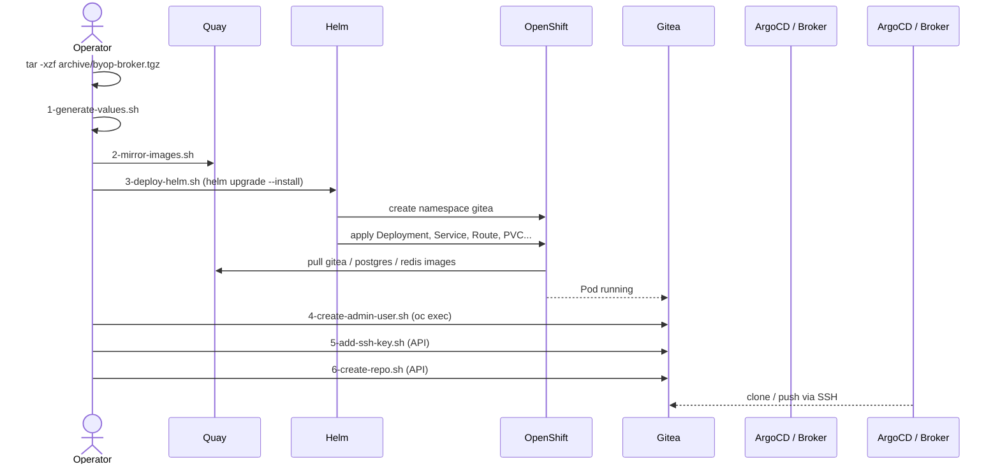

# Gitea — Deployment Guide

## Scripts

| Orchestrator | `deploy-gitea.sh` |
|---|---|
| Phase 1 | `1-generate-values.sh` — Generate values file |
| Phase 2 | `2-mirror-images.sh` — Mirror images to Quay |
| Phase 3 | `3-deploy-helm.sh` — Deploy with Helm |
| Phase 4 | `4-create-admin-user.sh` — Create admin user |
| Phase 5 | `5-add-ssh-key.sh` — Add SSH public key |
| Phase 6 | `6-create-repo.sh` — Create gitops repository |
| Outputs | `show-gitea-outputs.sh` — Display SSH host, port, and user ID |

---

## Overview

This guide covers the full **Gitea** deployment on an air-gapped OpenShift cluster:

0. Extract the source
1. Generate the values file
2. Mirror images to the private Quay registry
3. Deploy with `helm upgrade --install`
4. Create the admin user
5. Add the SSH public key
6. Create the `gitops` repository

Gitea is the self-hosted Git server for the GitOps workflow. ArgoCD pulls from it via SSH; the broker pushes manifests to it when a user provisions a service.

> **Automated alternative:** You can run the scripts in [`tools.md`](./tools.md) instead. Each phase can be run individually or all at once via `deploy-gitea.sh`.

---

## Deployment Flow



---

## Prerequisites

### Tools

| Tool | Version | Purpose |
|------|---------|---------|
| `podman` | any recent | Mirror images to Quay |
| `helm` | ≥ 3.x | Deploy the Helm chart |
| `oc` | matching cluster | Target cluster access + exec into pod |
| `curl` | any | Post-install Gitea API calls |

- Set your kubeconfig correctly before running any command.
- Configure default storage on the target cluster.

### Generate the SSH key pair

If you do not already have a dedicated Ed25519 key for Gitea, generate one now:

```bash
ssh-keygen -t ed25519 -f ~/.ssh/gitea_ed25519 -N "" -C "gitops"
```

This produces `~/.ssh/gitea_ed25519` (private key) and `~/.ssh/gitea_ed25519.pub` (public key). The private key is used in the broker values file; the public key is registered in Gitea in Step 5.

### Information needed before you start

| Information | Where to find it | Example |
|-------------|-----------------|---------|
| Quay registry hostname | Quay Web UI → top bar | `registry-quay-quay-enterprise.apps.<domain>` |
| `gitea+gitea_push` robot token | Quay Web UI → org `gitea` → Robot Accounts | `<token string>` |
| Cluster apps domain | `oc get ingresses.config cluster -o jsonpath='{.spec.domain}'` | `apps.mycluster.example.com` |
| Admin password to set | Chosen by operator | strong password |
| Admin email | Chosen by operator | `gitops@example.com` |

Export these environment variables once before starting:

```bash
export CLUSTER_DOMAIN="<cluster-apps-domain>"  # e.g. apps.mycluster.example.com
export QUAY_REGISTRY="registry-quay-quay-enterprise.apps.<domain>"
export GITEA_ROBOT_TOKEN="<get from Quay UI — gitea+gitea_push>"
export GITEA_URL="https://gitea-gitea.${CLUSTER_DOMAIN}"
export GITEA_PASSWORD="<admin password>"
export GITEA_EMAIL="<admin email>"
export GITEA_SSH_PUBLIC_KEY="$(cat ~/.ssh/gitea_ed25519.pub)"
export GITEA_SSH_KEY_PATH="~/.ssh/gitea_ed25519"
```

After installation:

```bash
export GITEA_POD="$(oc get pod -n gitea -l app.kubernetes.io/name=gitea -o jsonpath='{.items[0].metadata.name}')"
```

> **Security note**: never commit tokens or passwords to version control. Store them in a secrets manager or a local `.env` file excluded from git.

---

## Step 0 — Extract Source

```bash
tar -xzf archive/byop-broker.tgz
```

Then navigate to the `gitea/` subdirectory:

```bash
cd byop-broker/gitea
```

---

## Step 1 — Generate the Values File

`1-generate-values.sh` produces a `values.yaml` configured for your cluster. You can also build it manually from the template below.

Copy the template to a file named after your target cluster (e.g. `my-cluster.yaml`) and fill in every `# ← CUSTOMIZE` section:

```yaml
image:
  registry: ""          # $QUAY_REGISTRY
  repository: "gitea/gitea"

gitea:
  config:
    server:
      DOMAIN: ""        # gitea-gitea.$CLUSTER_DOMAIN

route:
  enabled: true

storage:
  persistentVolumeClaimName:
  requestedSize: 10Gi
  # className: ceph-rbd-platform

postgres:
  enabled: true
  image:
    registry: ""        # $QUAY_REGISTRY
    repository: "gitea/postgres"
    tag: "13.12"
  settings:
    superuserPassword: ""   # $GITEA_PASSWORD
  userDatabase:
    name: "gitea"
    user: "gitea"
    password: ""            # $GITEA_PASSWORD
  storage:
    requestedSize: 10Gi

redis:
  enabled: true
  image:
    registry: ""        # $QUAY_REGISTRY
    repository: "gitea/redis"
```

### Customization Checklist

| # | Field | Required | Notes |
|---|-------|----------|-------|
| 1 | `image.registry` | ✅ | Quay hostname for your cluster |
| 2 | `gitea.config.server.DOMAIN` | ✅ | Must match the OpenShift Route hostname |
| 3 | `storage.requestedSize` | ✅ | Adjust to available storage |
| 3 | `storage.className` | Optional | Only if no default StorageClass |
| 4 | `postgres.image.registry` | ✅ | Same Quay hostname |
| 4 | `postgres.settings.superuserPassword` | ✅ | Use a strong password |
| 4 | `postgres.userDatabase.password` | ✅ | Use a strong password |
| 5 | `redis.image.registry` | ✅ | Same Quay hostname |

---

## Step 2 — Mirror Images to Quay

`2-mirror-images.sh` mirrors all required images. To do it manually:

```bash
podman login -u="gitea+gitea_push" -p="${GITEA_ROBOT_TOKEN}" ${QUAY_REGISTRY}

# Gitea application
podman pull docker.io/gitea/gitea:1.26.2
podman tag  docker.io/gitea/gitea:1.26.2 ${QUAY_REGISTRY}/gitea/gitea:1.26.2
podman push ${QUAY_REGISTRY}/gitea/gitea:1.26.2

# PostgreSQL
podman pull docker.io/library/postgres:13.12
podman tag  docker.io/library/postgres:13.12 ${QUAY_REGISTRY}/gitea/postgres:13.12
podman push ${QUAY_REGISTRY}/gitea/postgres:13.12

# Redis
podman pull docker.io/library/redis:7.0.12
podman tag  docker.io/library/redis:7.0.12 ${QUAY_REGISTRY}/gitea/redis:7.0.12
podman push ${QUAY_REGISTRY}/gitea/redis:7.0.12
```

---

## Step 3 — Deploy with Helm

`3-deploy-helm.sh` runs the Helm install. All `helm` commands must be run from the **`gitea/` subdirectory** (Step 0):

```
byop-broker/
└── gitea/            ← run helm from here
    ├── chart/
    └── my-cluster.yaml   ← your values file
```

```bash
helm upgrade --install gitea ./chart \
  --namespace gitea \
  --create-namespace \
  --values my-cluster.yaml
```

> The `--create-namespace` flag is idempotent — safe to keep on upgrades too.

### Verify the rollout

```bash
# Watch pod status
oc get pods -n gitea -w

# Check the Gitea route
oc get route -n gitea

# Inspect Gitea logs
oc logs -n gitea deployment/gitea --tail=50
```

### Roll back if needed

```bash
# List release history
helm history gitea -n gitea

# Roll back to the previous revision
helm rollback gitea -n gitea
```

---

## Step 4 — Create the Admin User

`4-create-admin-user.sh` creates the `gitops` admin user inside the running pod. To do it manually:

```bash
oc exec -n gitea "${GITEA_POD}" -- \
  gitea admin user create \
  --username "gitops" \
  --password "${GITEA_PASSWORD}" \
  --email "${GITEA_EMAIL}" \
  --admin \
  --must-change-password=false
```

---

## Step 5 — Add the SSH Public Key

`5-add-ssh-key.sh` registers the public key via the Gitea API. To do it manually:

```bash
curl -sk -X POST "${GITEA_URL}/api/v1/user/keys" \
  -H "Content-Type: application/json" \
  -u "gitops:${GITEA_PASSWORD}" \
  -d "{\"key\": \"${GITEA_SSH_PUBLIC_KEY}\", \"read_only\": false, \"title\": \"gitops-key\"}"
```

---

## Step 6 — Create the `gitops` Repository

`6-create-repo.sh` creates the repository via the Gitea API. To do it manually:

```bash
curl -sk -X POST "${GITEA_URL}/api/v1/user/repos" \
  -H "Content-Type: application/json" \
  -u "gitops:${GITEA_PASSWORD}" \
  -d '{
    "name": "gitops",
    "private": false,
    "auto_init": true,
    "default_branch": "main"
  }'
```

### Verify

```bash
# Confirm the repo is reachable
curl -sk "${GITEA_URL}/gitops/gitops" | grep -o "<title>.*</title>"
```

---

## Outputs — Retrieve SSH Host, Port, and User ID

`show-gitea-outputs.sh` prints all values needed by subsequent components. To retrieve them manually:

### SSH host and port

The Gitea SSH service is exposed on a NodePort assigned at deployment time:

```bash
export GITEA_HOST=$(oc get nodes -o jsonpath='{.items[0].status.addresses[?(@.type=="InternalIP")].address}')
export GITEA_SSH_PORT=$(oc get svc -n gitea -o jsonpath='{.items[?(@.spec.ports[0].name=="ssh")].spec.ports[0].nodePort}')

echo "GITEA_HOST: ${GITEA_HOST}"
echo "GITEA_SSH_PORT: ${GITEA_SSH_PORT}"
```

### Numeric user ID

The Gitea SSH URL requires the internal numeric ID of the `gitops` user:

```bash
export GITEA_USER_ID=$(curl -sk \
  "${GITEA_URL}/api/v1/users/gitops" \
  -u "gitops:${GITEA_PASSWORD}" \
  | grep -o '"id":[0-9]*' | head -1 | cut -d: -f2)

echo "Gitea user ID: ${GITEA_USER_ID}"
```

Keep `GITEA_HOST`, `GITEA_SSH_PORT`, and `GITEA_USER_ID` — they are required by the ArgoCD and broker deployment guides.

---
*Made with IBM Bob*
