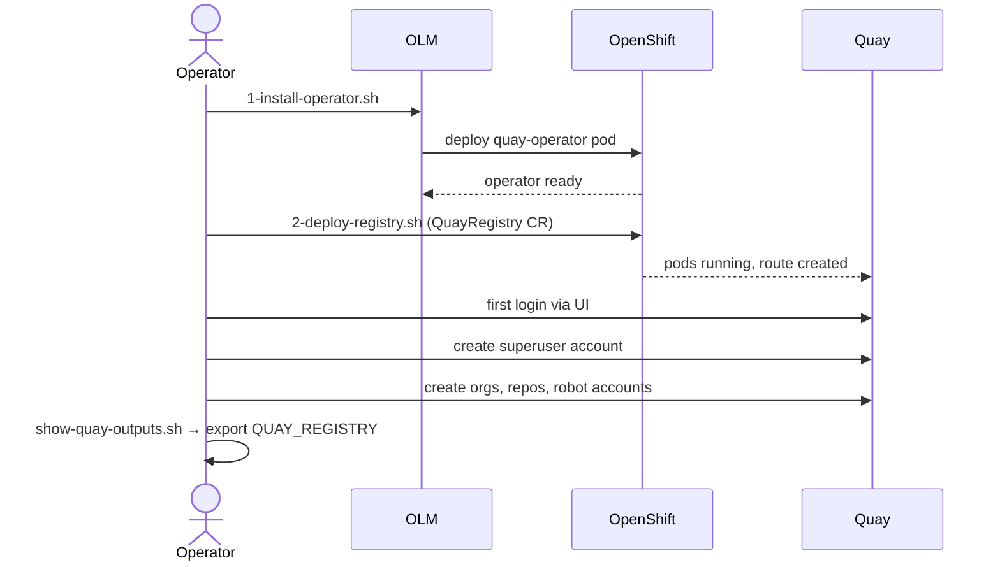

# Quay — Deployment Guide

## Scripts

| Orchestrator | `deploy-quay.sh` |
|---|---|
| Phase 1 | `1-install-operator.sh` — Install Quay Operator via OLM |
| Phase 2 | `2-deploy-registry.sh` — Deploy QuayRegistry CR, wait for Available |

---

## Overview

This guide covers the full **Quay Enterprise** deployment on an air-gapped OpenShift cluster:

1. Install the Quay Operator via OLM
2. Deploy the QuayRegistry custom resource
3. First login and create the superuser account
4. Create organizations, repositories, and robot accounts

Quay acts as the private container registry that all other components (ArgoCD, Gitea, BYOP Broker) pull images from. The other deployment guides use these robot accounts.

> **Automated alternative:** You can run the scripts in [`tools.md`](./tools.md) instead. Each phase can be run individually or all at once via `deploy-quay.sh`.

---

## Deployment Flow



---

## Prerequisites

> **Sovereign Core:** Quay is already deployed on Sovereign Core clusters. Skip Steps 1 and 2 — proceed directly to [Step 3](#step-3--first-login-and-create-superuser).

### Tools

| Tool | Purpose |
|------|---------|
| `oc` | Cluster access, apply CRs, read status |

- Ensure your kubeconfig points to the correct cluster before running any command.

### Information needed before you start

| Information | Where to find it |
|-------------|-----------------|
| Cluster apps domain | `oc get ingresses.config cluster -o jsonpath='{.spec.domain}'` |

Export this environment variable once before starting:

```bash
export CLUSTER_DOMAIN="apps.<domain>"   # e.g. apps.ocp.example.com
```

> **Security note**: never commit tokens or credentials to version control. Store them in a secrets manager or a local `.env` file excluded from git.

---

## Step 1 — Install Operator

`1-install-operator.sh` creates the required namespaces, applies the OLM subscription, and waits for the operator pod to become ready. To do it manually:

```bash
# Create namespaces (idempotent)
oc create namespace quay-enterprise --dry-run=client -o yaml | oc apply -f -
oc create namespace quay-operator   --dry-run=client -o yaml | oc apply -f -

# Apply OLM objects
oc apply -f - <<EOF
apiVersion: operators.coreos.com/v1alpha1
kind: CatalogSource
metadata:
  name: redhat-operators
  namespace: openshift-marketplace
spec:
  sourceType: grpc
  image: registry.redhat.io/redhat/redhat-operator-index:v4.16
  displayName: Red Hat Operators
  publisher: Red Hat
---
apiVersion: operators.coreos.com/v1
kind: OperatorGroup
metadata:
  name: quay-operator-group
  namespace: quay-operator
spec:
  targetNamespaces:
    - quay-enterprise
---
apiVersion: operators.coreos.com/v1alpha1
kind: Subscription
metadata:
  name: quay-operator
  namespace: quay-operator
spec:
  channel: stable-3.13
  name: quay-operator
  source: redhat-operators
  sourceNamespace: openshift-marketplace
EOF
```

### Verify

```bash
# Watch the operator pod come up
oc get pods -n quay-operator -w

# Confirm the CSV is Succeeded
oc get csv -n quay-operator
```

---

## Step 2 — Deploy Registry

`2-deploy-registry.sh` applies the `QuayRegistry` CR and polls until the registry reports `Available`. To do it manually:

```bash
oc apply -f - <<EOF
apiVersion: quay.redhat.com/v1
kind: QuayRegistry
metadata:
  name: quay
  namespace: quay-enterprise
spec:
  configBundleSecret: ""
  components:
    - kind: clair
      managed: true
    - kind: postgres
      managed: true
    - kind: objectstorage
      managed: true
    - kind: redis
      managed: true
    - kind: horizontalpodautoscaler
      managed: true
    - kind: route
      managed: true
    - kind: mirror
      managed: true
    - kind: monitoring
      managed: false
    - kind: tls
      managed: false
EOF
```

Poll for readiness (up to 10 minutes — initial startup takes time):

```bash
for i in $(seq 1 60); do
  STATUS=$(oc get quayregistry quay -n quay-enterprise \
    -o jsonpath='{.status.conditions[?(@.type=="Available")].status}' 2>/dev/null)
  [[ "$STATUS" == "True" ]] && echo "Quay is Available" && break
  echo "Waiting... ($i/60)"
  sleep 10
done
```

### Verify

```bash
# Confirm registry endpoint
oc get quayregistry quay -n quay-enterprise -o jsonpath='{.status.registryEndpoint}'

# Watch all pods in the namespace
oc get pods -n quay-enterprise -w
```

---

## Step 3 — First Login and Create Superuser

This step is performed through the Quay web UI.

1. Retrieve the registry URL:
   ```bash
   oc get quayregistry quay -n quay-enterprise -o jsonpath='{.status.registryEndpoint}'
   ```
2. Open the URL in a browser (`https://<registryEndpoint>`).
3. On first load, Quay presents a **Create Superuser** screen — fill in a username, email, and password, then click **Create Super User**.
4. Log in with the credentials you just created.

> The superuser account has full administrative access to Quay. Store these credentials securely.

---

## Step 4 — Create Organizations, Repositories, and Robot Accounts

This is a one-time setup performed through the Quay UI. It creates the structure that all downstream deployment guides depend on.

### 4a — Create Organizations and Repositories

Log in to Quay Enterprise and create the following structure:

| Organization | Repositories | Notes |
|---|---|---|
| `argoproj` | `argocd`, `redis` | Always required |
| `byop` | `byop-broker`, `byop-catalog-app`, `mariadb`, `mongo` | Always required — broker + minimum example services |
| `byop` | `valkey`, `postgres`, `mysql`, `rabbitmq`, `odoo`, `keycloak`, `memcached`, `redis`, `nginx`, `busybox`, `vault`, `etcd`, `memcached-exporter`, `langflow`, `langflow-frontend`, `olgranitehelm` | Required per service — create only repos for services you intend to mirror |
| `gitea` | `gitea`, `postgres`, `redis` | Always required |

For each organization: **Create New Organization** → navigate into it → **Create New Repository** for each entry above.

> **Note:** Quay does not auto-create repositories on push. All `byop` repos targeted by `broker/3-mirror-extra-images.sh` must exist **before** running that script.

### 4b — Create Robot Accounts

For each organization, create one robot account with **write** permissions to all its repositories:

| Organization | Robot name | Login username |
|---|---|---|
| `argoproj` | `argocd_push` | `argoproj+argocd_push` |
| `byop` | `byop_push` | `byop+byop_push` |
| `gitea` | `gitea_push` | `gitea+gitea_push` |

For each robot: **Robot Accounts** in the left sidebar → **Create Robot Account** → enter the name → grant **Write** to all repositories in that organization → save the generated token.

> Store each token securely. You will need them when following the ArgoCD, Gitea, and BYOP Broker deployment guides.

---

## Outputs

Run `show-quay-outputs.sh` to print the registry endpoint as an exportable variable:

```bash
./show-quay-outputs.sh
```

Expected output:

```bash
export QUAY_REGISTRY=registry-quay-quay-enterprise.apps.<domain>
```

To retrieve it manually:

```bash
oc get quayregistry quay -n quay-enterprise \
  -o jsonpath='{.status.registryEndpoint}'
```

Set `QUAY_REGISTRY` in your shell before running any downstream deployment guide (ArgoCD, Gitea, BYOP Broker).

---

*Made with IBM Bob*
