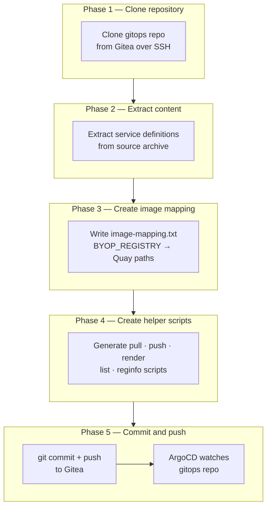

# GitOps Repository — Setup Guide

## Scripts

| Orchestrator | `deploy-gitops.sh` |
|---|---|
| Phase 1 | `1-clone-repo.sh` — Clone the gitops repository |
| Phase 2 | `2-extract-content.sh` — Extract service definitions from archive |
| Phase 3 | `3-create-image-mapping.sh` — Create image registry mapping file |
| Phase 4 | `4-create-helper-scripts.sh` — Create helper scripts (`pull`, `push`, `render`, `list`, `reginfo`) |
| Phase 5 | `5-commit-and-push.sh` — Commit and push to Gitea |

---

## Overview

This guide populates the Gitea `gitops` repository with the service definitions that ArgoCD and the broker use to provision workloads. Run it once after Gitea is deployed and the repository is created.



1. Clone the repository
2. Extract the service definitions from the archive
3. Create the image registry mapping file
4. Create helper scripts
5. Commit and push to Gitea

> **Automated alternative:** You can run the scripts in [`tools.md`](./tools.md) instead. Each phase can be run individually or all at once via `deploy-gitops.sh`.

---

## Prerequisites

- Gitea deployed and the `gitops` repository created (see [`../gitea/gitea-deployment.md`](../gitea/gitea-deployment.md))
- `./tools/service-render` binary available in the extracted source package
- SSH key registered in Gitea (added in Gitea deployment Step 5)

Export these environment variables before starting:

```bash
export GITEA_HOST=""        # from Gitea deployment Outputs
export GITEA_SSH_PORT=""    # from Gitea deployment Outputs
export GITEA_USER_ID=""     # from Gitea deployment Outputs
export GITEA_SSH_KEY_PATH="~/.ssh/gitea_ed25519"

export BYOP_REGISTRY="registry-quay-quay-enterprise.apps.<domain>"
# Example: registry.example.com

export GITEA_SSH_URL="ssh://${GITEA_USER_ID}@${GITEA_HOST}:${GITEA_SSH_PORT}/gitops/gitops.git"
```

---

## Step 1 — Clone the Repository

`1-clone-repo.sh` clones the empty `gitops` repository from Gitea. To do it manually:

```bash
git clone ${GITEA_SSH_URL} gitops-repo
cd gitops-repo
```

---

## Step 2 — Extract Service Definitions

`2-extract-content.sh` unpacks the service definitions from the archive into the cloned repository. To do it manually:

```bash
tar -xzf /path/to/archive/sample.tar.gz
```

---

## Step 3 — Create the Image Mapping File

`3-create-image-mapping.sh` generates `image-mapping.txt` at the root of the repository. To do it manually:

```bash
cat > image-mapping.txt <<EOF
BYOP_REGISTRY -> ${BYOP_REGISTRY}
EOF
```

---

## Step 4 — Create Helper Scripts

`4-create-helper-scripts.sh` writes five convenience scripts into the root of the cloned repository. Each script is a small wrapper around the matching tool in `tools/`.

| Script | Usage | Description |
|--------|-------|-------------|
| `pull` | `./pull` | `git pull` over SSH using the configured Gitea key |
| `push` | `./push` | `git push` over SSH using the configured Gitea key |
| `render` | `./render <name>helm/v1` | Renders a service: replaces `BYOP_REGISTRY` and image references, generates the ArgoCD ApplicationSet, sets the `latest` symlink |
| `list` | `./list` | Lists all services with version, rendered status, and whether each is active through the `latest` link |
| `reginfo` | `./reginfo <name>helm` | Extracts broker registration info from the active release: name, description, base64 schema, metrics |

To create these scripts manually:

```bash
# Run from the root of the cloned gitops-repo directory

cat > pull    <<EOF
#!/usr/bin/env bash
GIT_SSH_COMMAND="ssh -i ${GITEA_SSH_KEY_PATH} -o StrictHostKeyChecking=no -o UserKnownHostsFile=/dev/null" git pull
EOF

cat > push    <<EOF
#!/usr/bin/env bash
GIT_SSH_COMMAND="ssh -i ${GITEA_SSH_KEY_PATH} -o StrictHostKeyChecking=no -o UserKnownHostsFile=/dev/null" git push
EOF

cat > render <<'EOF'
#!/usr/bin/env bash
./tools/service-render --images --applicationset services/"$1" --mapping image-mapping.txt --force \
  --argocd-namespace argocd --repo-url GITEA_SSH_URL
if [ -d "services/$1" ]; then
  (cd "services/$1/.."; rm -f latest)
  version=$(basename "$1")
  (cd "services/$1/.."; ln -s "${version}.rendered" latest)
fi
EOF

cat > list <<'EOF'
#!/usr/bin/env bash
./tools/service-list "$@"
EOF

cat > reginfo <<'EOF'
#!/usr/bin/env bash
./tools/service-reginfo "$@"
EOF

chmod +x pull push render list reginfo
```

### Usage examples

```bash
# Inspect the state of all services
./list

# Render a service and make it active
./render nginxhelm/v1
git add .
git commit -m "enable nginxhelm/v1"
./push

# Get the broker registration payload for a rendered service
./reginfo nginxhelm
```

The services included in the initial archive are:

| Service | Directory |
|---------|-----------|
| etcd | `services/etcdhelm/v1` |
| Keycloak | `services/keycloakhelm/v1` |
| MariaDB | `services/mariadbhelm/v1` |
| MariaDB KZ | `services/mariadbkz/v1` |
| Memcached | `services/memcachedhelm/v1` |
| MongoDB | `services/mongodbhelm/v1` |
| MySQL | `services/mysqldbhelm/v1` |
| Odoo | `services/odoohelm/v1` |
| PostgreSQL | `services/postgreshelm/v1` |
| RabbitMQ | `services/rabbitmqhelm/v1` |
| Redis | `services/redishelm/v1` |
| Valkey | `services/valkeyhelm/v1` |
| Vault | `services/vaulthelm/v1` |

---

## Step 5 — Commit and Push

`5-commit-and-push.sh` stages all changes, commits, and pushes to Gitea. To do it manually:

```bash
git add .
git commit -m "chore: initialise gitops service definitions"
git push origin main
```

### Verify

```bash
# Confirm all services are present in the remote
git ls-remote origin
```

---
*Made with IBM Bob*
